# 音乐表示与条件检索

**任务现状综述**

任务说明：把歌曲音频与用户文字需求放到可以比较的表示空间，再根据语义、情绪描述或音乐偏好查找相关歌曲。音乐编码、跨模态对齐和条件检索共同组成编码—相似度—召回流程。

---

## [P01] MusicSem: A Semantically Rich Language–Audio Dataset of Natural Music Descriptions（2026）

罗切斯特大学、新加坡国立大学、上海交通大学、新加坡管理大学和穆罕默德·本·扎耶德人工智能大学等团队合作，公开为 [2026 年 arXiv 预印本](https://arxiv.org/abs/2602.17769)。

**研究内容**

作者针对音乐文本常停留在乐器、流派等标签、难以表达真实用户使用场景和情绪体验的问题，构建 MusicSem。数据包含 32,493 个语言—音频对，文字源于 Reddit 的自然音乐讨论，保留原始帖子、歌曲与艺人、语义摘要及音乐音频，并分为描述、氛围、情境、元数据和上下文五类语义。作者借鉴大语言模型的信息提取与核验，用两轮模型检查和歌曲实体验证减少错误，再检验 CLAP 等音频—文本模型能否理解“失恋时听的歌”“适合某种活动的音乐”等表达。创新重点是自然需求的数据构建和语义评测，能够补充仅靠标签进行条件召回的数据。

**方法与架构**

*原 Figure 3：MusicSem 数据构建方法流程。*

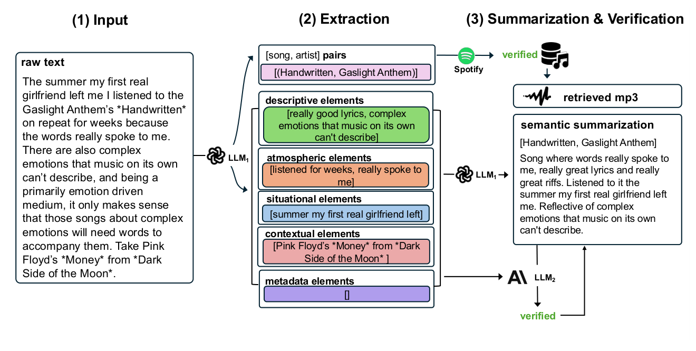

原始帖子先提取歌曲实体和五类语义，再验证歌曲、获取音频并生成经过核验的描述。该图展示数据构建流程；本文没有提出新的音乐编码网络。

**损失与优化目标**

论文的主要贡献是数据与评测，另有 CLAP 微调实验，没有提出独立的新损失公式。音频—文本模型需要学习配对描述与歌曲的对应关系；检索结果采用 MRR、Recall、NDCG 及语义敏感性等指标评价。检索指标用于评价，不能直接写成本文新提出的训练损失。

---

## [P02] Text2Tracks: Prompt-based Music Recommendation via Generative Retrieval（2025）

Spotify 研究团队提出，作者包括长期研究搜索与推荐的 Mounia Lalmas、Andreas Damianou 和 Gustavo Penha 等，公开为 [2025 年预印本](https://guzpenha.github.io/guzblog/publications/)。

**研究内容**

作者要解决用户用自然语言提出音乐需求时，语言模型生成歌名容易出现实体匹配问题、解码开销较大的问题。实验使用 Spotify 歌单数据，将有描述性的歌单文字作为查询，将其中歌曲作为相关歌曲，形成“查询—歌曲 ID”的训练对；这不是逐位置的情绪轨迹数据。作者借鉴生成式检索，比较歌名、整数和学习得到的语义 ID，并将歌单共现得到的协同过滤表示离散化。语言模型直接生成可映射到曲库的 ID，推理用多样化束搜索召回多首歌曲，创新主要在歌曲标识的设计和文字条件召回。

**方法与架构**

*原 Figure 1：Text2Tracks 与歌名生成方案的对比。*

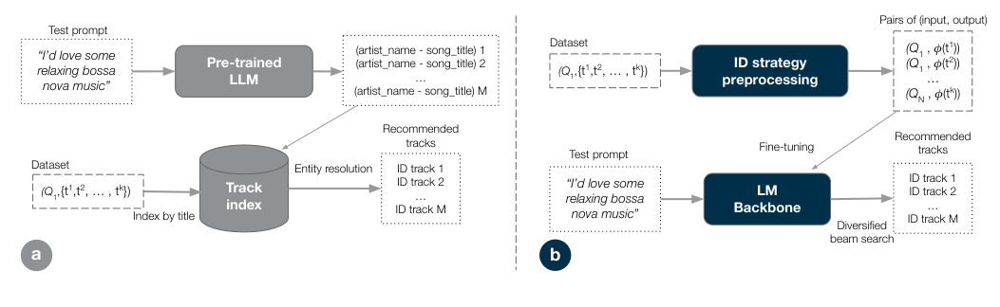

左侧先生成歌名再做实体解析；右侧把训练查询与歌曲 ID 配对，微调语言模型后直接解码 ID。束搜索用于生成不同歌曲候选，原文任务没有联合优化整份歌单的顺序。

**损失与优化目标**

原文把每个查询与其相关歌曲拆成多个序列到序列训练对，微调语言模型预测歌曲 ID 序列，没有单独给出新的损失公式。推理阶段的多样性惩罚用于束搜索，不能当作本文额外的训练损失。

---

## [P03] MuQ: Self-Supervised Music Representation Learning with Mel Residual Vector Quantization（2025）

上海交通大学 X-LANCE 实验室、南京大学和腾讯 AI Lab 等团队合作，[发表于 IEEE TASLP](https://ziyang.tech/)。这是音频、语音与语言处理领域的重要 IEEE Transactions 期刊，属于 CCF B 类。

**研究内容**

作者针对音乐自监督训练中的离散教师目标不够稳定、音乐细节容易丢失的问题，提出 MuQ。训练数据主要是无人工标签的音乐音频，分别研究约 900 小时的 Music4all 和 16 万小时的大规模音乐；另以约 13 万小时音乐—文本数据训练 MuQ-MuLan。作者借鉴遮蔽预测与残差向量量化，用 Mel-RVQ 为梅尔频谱产生多层离散目标，再训练 Conformer 预测遮蔽位置。下游实验包含 EmoMusic 的连续效价—唤醒度回归；MuQ-MuLan 则增加文本对齐，使同一表示可以服务音乐属性学习和文字条件检索。

**方法与架构**

*原 Figure 2：MuQ 音乐自监督预训练架构。*

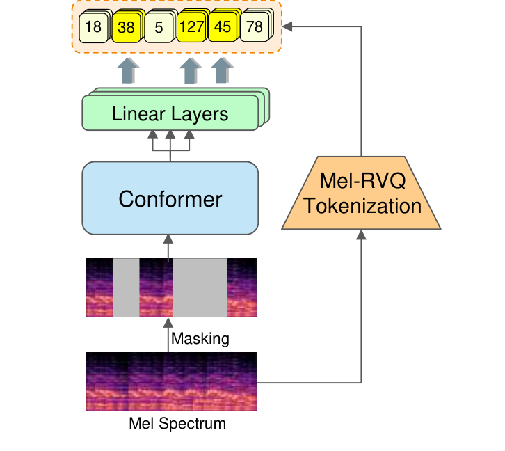

梅尔频谱的一路生成 Mel-RVQ 离散目标，另一路经过遮蔽、Conformer 和多个线性预测头，恢复各级量化目标。

*原 Figure 4：MuQ-MuLan 音乐—文本对齐架构。*

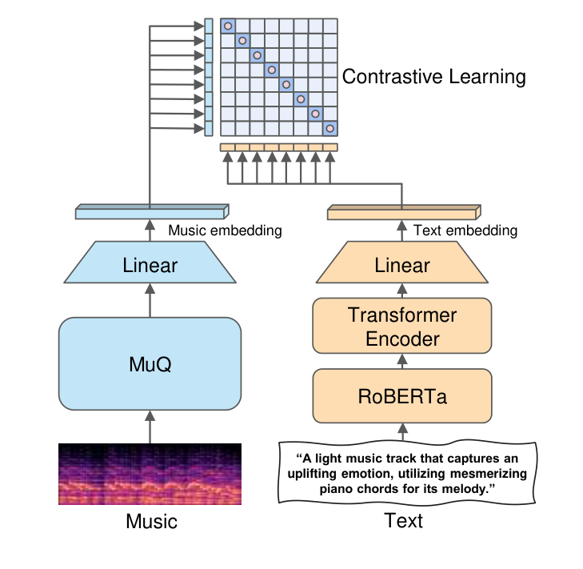

MuQ 编码音频，RoBERTa 与 Transformer 编码文本，分别投影后做跨模态对比学习。

**损失与优化目标**

MuQ 主干采用遮蔽位置的多级离散目标交叉熵；Mel-RVQ 本身的训练目标由码本项、承诺项和频谱重建项组成：

$$
\mathcal L_{\mathrm{RVQ}}=\mathcal L_{\mathrm{code}}+0.25\mathcal L_{\mathrm{commit}}+\mathcal L_{\mathrm{recon}}.
$$

MuQ-MuLan 另用音频—文本对比目标学习检索空间。以上是基础模型训练目标；将表示用于连续 VA 回归时，还需要独立训练情绪预测头。

---

## [P04] CLaMP 3: Universal Music Information Retrieval Across Unaligned Modalities and Unseen Languages（2025）

中央音乐学院、清华大学、香港科技大学和韩国科学技术院（KAIST）等团队合作，发表于 ACL 2025 的 Findings 论文集。

**研究内容**

作者要解决的是音频、MIDI、乐谱和自然语言之间缺少完整配对、不同语言的查询难以通用的问题。训练使用 M4-RAG，约含 231 万条音乐—文本记录，其中约 58 万条 ABC 乐谱、17 万条 MIDI 和 156 万条音频；这些记录以文本为桥梁，并非每首音乐都有全部模态。评测使用含约 1,000 个乐谱—音频—文本组合的 WikiMT-X。作者借鉴双编码器对比学习，让不同音乐编码器先后对齐到语言空间，改进重点是统一未直接配对的音乐模态，并支持训练中未见过的查询语言。

**方法与架构**

*Figure 1：总体跨模态、跨语言对齐目标。*

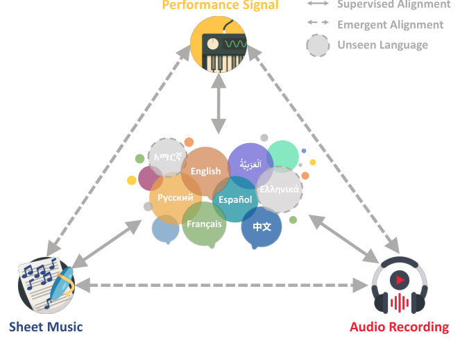

实线表示训练阶段存在配对监督的模态对齐；虚线表示通过共享文本空间产生的未配对模态之间的涌现式对齐；多语言文本编码器支持训练阶段未出现的语言。

*Figure 2：CLaMP 3 框架。*

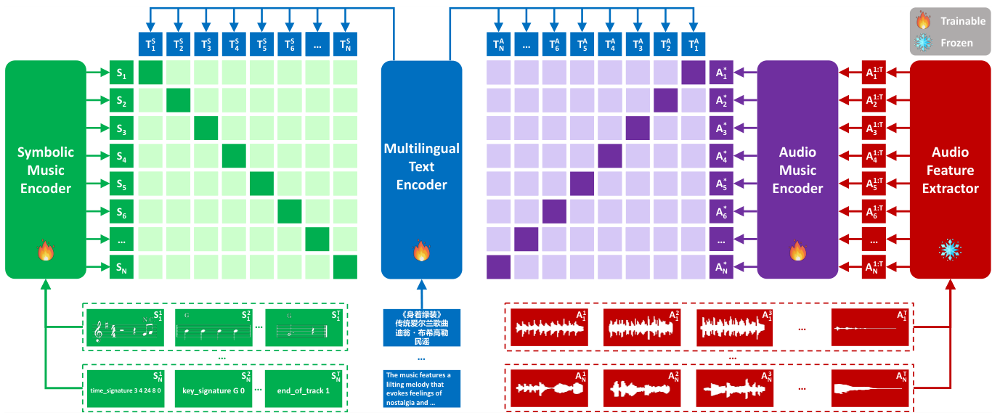

图中展示乐谱与演奏信号的分段和符号编码器、音频的五秒切片与 MERT 特征提取，以及多语言文本编码器，最后通过对比学习进行跨模态对齐。

原文架构描述包括：

- sheet music 输入 symbolic music encoder；
- performance/MIDI 输入演奏信号编码器；
- audio 切分为短片段后由音频编码器处理；
- 文本由多语言文本编码器处理；
- 各模态通过投影层形成共享表示；
- 训练目标为音乐模态和文本模态之间的对比学习。

**损失与优化目标**

原文使用对比学习/InfoNCE 类损失。用一般形式表示为：

$$
\mathcal{L}_{\mathrm{CL}}
=
-\frac{1}{N}
\sum_{i=1}^{N}
\log
\frac{
\exp\left(\operatorname{sim}(z_i^{t},z_i^{m})/\tau\right)
}{
\sum_{j=1}^{N}
\exp\left(\operatorname{sim}(z_i^{t},z_j^{m})/\tau\right)
}.
$$

其中，$z_i^t$ 是文本表示，$z_i^m$ 是音乐表示，$\tau$ 是温度参数。配对文本—音乐为正样本，同一 batch 内其他样本作为负样本。

让配对文本和音乐靠近，使不相关文本—音乐分离，从而建立共享表示空间。论文还描述多阶段对齐和冻结/解冻策略，以降低不同音乐编码器之间的 alignment drift。

---

## [P05] MMVA: Multimodal Matching Based on Valence and Arousal across Images, Music, and Musical Captions（2025）

韩国首尔大学团队提出，发表于 AAAI 2025 的 AI4Music 工作坊。AAAI 主会属于 CCF A 类，工作坊论文不直接标为主会 A 类论文。

**研究内容**

作者希望在图像、音乐和文字没有完整一一配对时，仍能学习情绪一致的匹配。IMEMNet-C 包含 24,756 张图像、25,944 个音乐片段和相应的 25,944 条音乐描述，描述由音乐字幕及语言模型生成方式补充，并整理为归一化 VA 监督。作者借鉴 CLIP、MERT 和 RoBERTa 的预训练表示，为三个模态分别预测 VA，再由拼接表示预测匹配分数。改进重点是用情绪关系组织不完全配对的三模态样本；论文演示文字检索音乐、图像检索音乐描述及唤醒度驱动的视频摘要。

**方法与架构**

*Figure 1：传统 one-to-one matching 与 random multimodal matching 对比。*

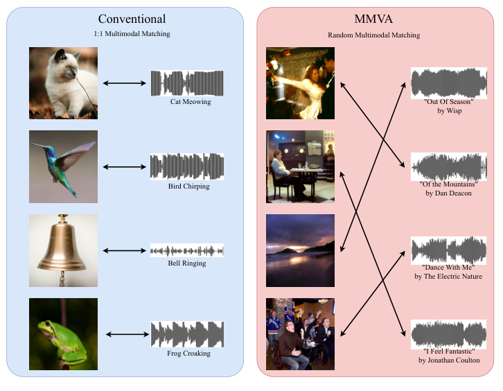

*Figure 2：MMVA 总体架构。*

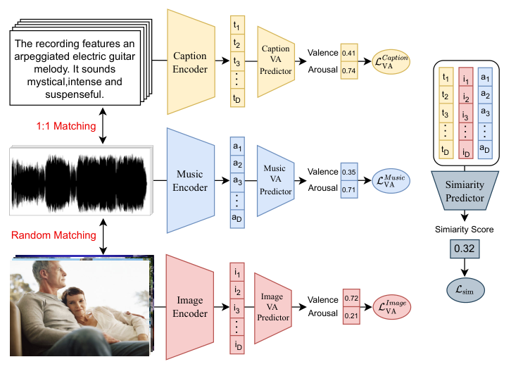

图中可核验：

- image encoder：CLIP ViT-B/32；
- music encoder：MERT-95M；
- caption encoder：RoBERTa-base；
- 每个模态有独立 VA predictor；
- 拼接三个 modality embeddings 后由 similarity predictor 输出匹配分数。

VA predictor 的输入/输出结构在原文中描述为 512 维 embedding 到 2 维 VA 输出的 MLP；similarity predictor 输入拼接后的 1536 维向量并输出标量。

**损失与优化目标**

对模态 $k\in\{\mathrm{Img},\mathrm{Mus},\mathrm{Cap}\}$，单模态 VA loss 为：

$$
\mathcal{L}_{\mathrm{VA}}^{k}
=\frac{1}{N}\sum_{n=1}^{N}
\left\|\mathbf{E}_{n}^{k}-\mathbf{Y}_{n}^{k}\right\|_{2}^{2}.
$$

similarity prediction loss 为：

$$
\mathcal{L}_{\mathrm{sim}}
=\frac{1}{N}\sum_{n=1}^{N}
\left(S_n-Y_n^{\mathrm{sim}}\right)^2.
$$

VA matching score 为：

$$
S(I_i,M_j)
=\exp\left(
-\frac{d\left(y^{I_i},y^{M_j}\right)}{\sigma_{a}^{b}}
\right),
$$

其中 $d$ 是两个 VA 向量的欧氏距离，$\sigma_a^b$ 是所有图像—音乐组合的平均距离。

总损失为：

$$
\mathcal{L}_{\mathrm{MMVA}}
=\mathcal{L}_{\mathrm{VA}}^{\mathrm{Img}}
+\mathcal{L}_{\mathrm{VA}}^{\mathrm{Mus}}
+\mathcal{L}_{\mathrm{VA}}^{\mathrm{Cap}}
+\mathcal{L}_{\mathrm{sim}}.
$$

原论文解释：三个模态分别保持自身 VA 信息，同时用 similarity predictor 学习 image–music–caption triplet 的情绪一致性；等权相加的目标用于训练不完全配对的三模态数据。

---

## [P06] MERT: Acoustic Music Understanding Model with Large-Scale Self-supervised Training（ICLR 2024）

香港科技大学、伦敦玛丽女王大学和美国卡内基梅隆大学等团队合作，发表于 ICLR 2024。按 CCF 2026 目录，ICLR 为 A 类会议，是机器学习表示研究的高水平国际会议。

**研究内容**

作者针对通用声音预训练难以同时保留音乐音色和音高结构的问题，开展音乐专用自监督训练。大规模版本使用约 16 万小时音乐，95M 参数版本使用约 1,000 小时子集；另有约 910 小时 music4all 数据训练的公开版本，不能混淆各版本的数据规模。数据主要是无人工任务标签的音乐音频，模型通过遮蔽预测学习表示，并在包含 EmoMusic 连续 VA 回归的 14 个下游任务上评价。作者借鉴 HuBERT 的遮蔽建模，同时加入声学教师和 CQT 音高教师，以兼顾音色与音乐音高信息。

**方法与架构**

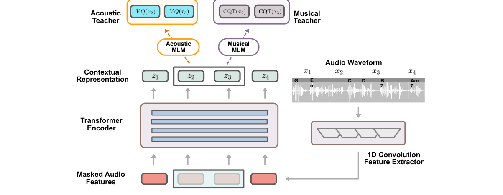

原 Figure 1，PDF 第 2 页。波形经卷积提取器和 Transformer；声学教师产生离散目标，CQT 教师提供音高相关监督。图片直接从正文裁取。

**损失与优化目标**

正文式 (5)–(6) 将声学目标预测与遮蔽位置的 CQT 重建组合：

$$
\mathcal L=\alpha\mathcal L_H+\mathcal L_{\mathrm{CQT}},\qquad
\mathcal L_{\mathrm{CQT}}=\sum_{t\in M}\|z_{\mathrm{CQT},t}-f_{\mathrm{CQT}}(x')_t\|_2^2.
$$

声学项学习离散教师目标，CQT 项强化音高信息；$\alpha$ 控制声学项权重，$M$ 为被遮蔽的位置。这是预训练目标，连续 VA 下游回归另行训练。

---

## [P07] CLaMP: Contrastive Language-Music Pre-training for Cross-Modal Symbolic Music Information Retrieval（ISMIR 2023）

中央音乐学院、微软亚洲研究院和清华大学团队合作，发表于 ISMIR 2023。ISMIR 是音乐信息检索领域的主要国际会议，CCF 2026 目录未收录。

**研究内容**

作者要解决自然语言难以直接检索符号音乐的问题。训练使用 WebMusicText 的 1,448,750 个符号音乐—英文文本对，乐谱统一表示为 ABC，文字来自元数据或评论；WikiMusicText 评测集包含 1,010 份 lead sheet 及标题、作者、流派和描述。作者借鉴遮蔽音乐建模和双编码器对比学习，先训练音乐编码器理解符号上下文，再与 RoBERTa 文本表示对齐。其改进重点是为符号音乐建立语言语义空间，支持文本检索与自然语言标签驱动的零样本分类。

**方法与架构**

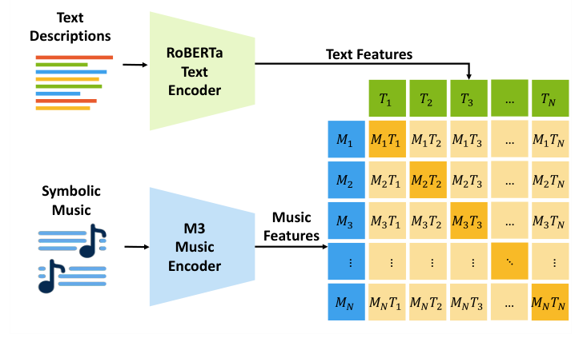

原 Figure 1，PDF 第 1 页。RoBERTa 文本编码器与 M3 符号音乐编码器对齐；其音乐输入是乐谱表示，不是音频波形。

**损失与优化目标**

音乐编码器首先学习遮蔽位置的音乐重建，跨模态阶段再使用批内配对音乐—文本的对比目标。前者学习符号音乐上下文，后者让语义匹配的音乐和文字表示接近。

---

## [P08] CLAP: Learning Audio Concepts From Natural Language Supervision（ICASSP 2023）

微软研究团队提出，正式发表于 ICASSP 2023（CCF B 类会议，音频、语音与信号处理领域的重要国际会议）；公开预印本始于 2022 年。

**研究内容**

作者希望让音频识别摆脱固定类别标签，使用户能用自然语言描述声音并执行零样本检索。训练汇集约 12.8 万个音频—文本对，覆盖多个一般音频来源，数据形式是音频片段和描述声音内容的文字；评测覆盖 8 个领域的 16 项任务。作者借鉴 CLIP 的双编码器对比学习，用音频编码器与文本编码器建立共享空间，使配对内容接近、无关内容分离。其创新重点是把开放词汇的自然语言监督引入一般音频概念学习，而非专门预测连续音乐情绪坐标。

**方法与架构**

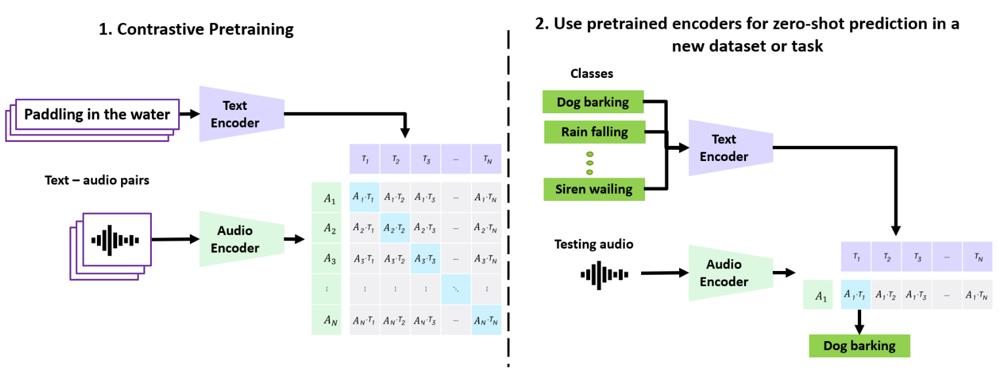

Figure 1 展示 audio encoder 和 text encoder，将音频—文本对通过 contrastive learning 映射到 joint multimodal space；测试时用 cosine similarity 进行 zero-shot classification/retrieval。

**损失与优化目标**

CLAP 使用 audio-to-text 和 text-to-audio 的对称对比学习。可写为：

$$
\mathcal{L}_{a\rightarrow t}
=-\frac{1}{N}\sum_{i=1}^{N}
\log
\frac{\exp(\operatorname{sim}(a_i,t_i)/\tau)}
{\sum_{j=1}^{N}\exp(\operatorname{sim}(a_i,t_j)/\tau)},
$$

$$
\mathcal{L}_{t\rightarrow a}
=-\frac{1}{N}\sum_{i=1}^{N}
\log
\frac{\exp(\operatorname{sim}(t_i,a_i)/\tau)}
{\sum_{j=1}^{N}\exp(\operatorname{sim}(t_i,a_j)/\tau)}.
$$

总损失为：

$$
\mathcal{L}_{\mathrm{CLAP}}
=\frac{1}{2}\left(\mathcal{L}_{a\rightarrow t}+\mathcal{L}_{t\rightarrow a}\right).
$$

其中 $a_i$ 与 $t_i$ 是第 $i$ 个音频和文字的表示，$N$ 是一批配对样本的数量，$\tau$ 调节相似度分布的尖锐程度。双向损失让正确配对在两个检索方向上都更接近，从而支持开放词汇和零样本推断。

---

## [P09] Large-scale Contrastive Language-Audio Pretraining with Feature Fusion and Keyword-to-Caption Augmentation（ICASSP 2023，LAION-CLAP）

加拿大 Mila、美国加州大学圣迭戈分校和 LAION 团队合作，发表于 ICASSP 2023（CCF B 类会议，音频与信号处理领域的重要国际会议）。

**研究内容**

作者针对音频—文本训练数据规模不足、音频长度与文字描述差异大的问题，构建 LAION-Audio-630K，包含 633,526 个音频—文本对，并比较 AudioSet、Clotho 和 AudioCaps 等训练组合。数据覆盖一般声音，样本是音频片段和自然语言描述，不是专门的音乐连续 VA 标注。作者借鉴 CLAP 双编码器对比学习，加入音频特征融合以处理不同长度输入，并通过关键词转描述增强文本监督。改进重点是扩大可用数据与提升跨模态检索、零样本分类的泛化能力。

**方法与架构**

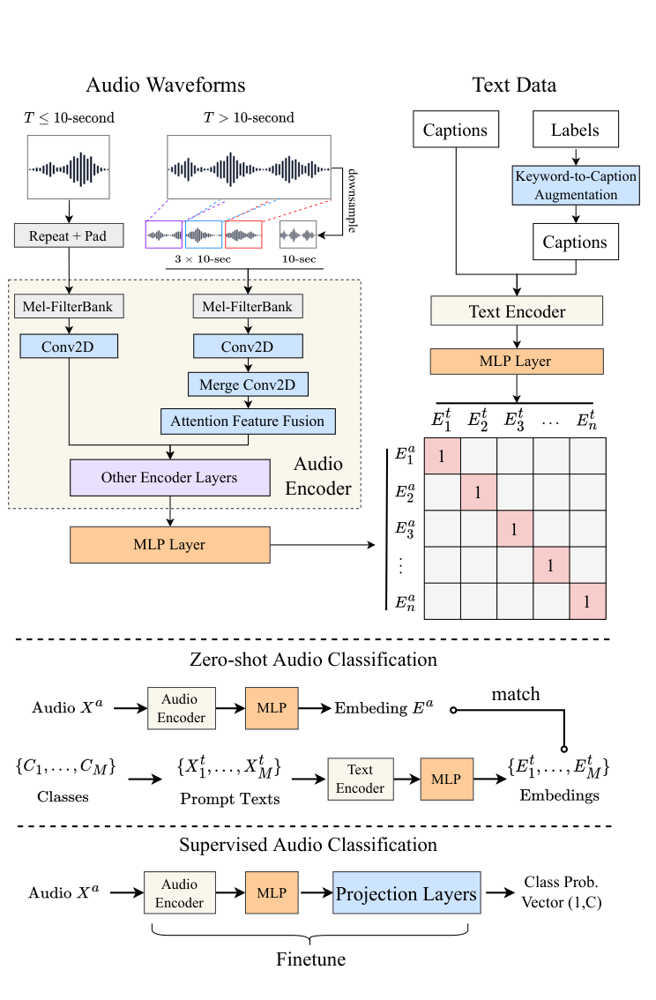

原 Fig. 1，PDF 第 2 页；正文图已包含双编码器、变长音频融合和 keyword-to-caption 路线，未使用附录图。

**损失与优化目标**

正文式 (3) 使用音频→文本、文本→音频双向对比交叉熵；正确配对为批内正样本。其目标建立语言语义空间，没有直接提供连续 VA 坐标。

---

## [P10] MuLan: A Joint Embedding of Music Audio and Natural Language（ISMIR 2022）

谷歌研究团队与韩国首尔大学合作，发表于 ISMIR 2022。ISMIR 是音乐信息检索领域的主要国际会议，CCF 2026 目录未收录，不填写虚构的 A／B／C 等级。

**研究内容**

作者针对音乐文本标注昂贵、检索系统只能处理固定标签的问题，使用约 4,400 万条音乐录音、总计约 37 万小时的训练数据，与网络音乐视频相关的短标签、较长描述和歌单信息等弱关联文本配对。数据形式是音乐音频和质量不完全一致的文字描述，并不是人工连续 VA 数据。作者借鉴双塔模型和跨模态对比学习，比较 ResNet-50 与 AST 音频编码器，并探索文本过滤。改进重点是利用大规模弱监督建立音乐—语言共享表示，支持自然语言音乐检索。

**方法与架构**

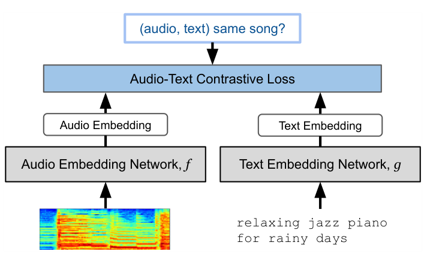

原 Figure 1，PDF 第 2 页。两个独立编码器输出归一化的音频和文本 embedding，再进行音频—文本对比训练；正文比较 ResNet-50 与 AST 音频塔。

**损失与优化目标**

正文第 3.1 节明确使用批内 Contrastive Multiview Coding（CMC）目标，critic 为：

$$
h[a,b]=\exp(a^\top b/\tau).
$$

每次随机选择一段音频及其一条关联文本作为正对，并以同批其他音频/文本构造负对。该目标拉近配对内容、区分错配内容；不把 CLAP 的一般双向交叉熵公式冒充 MuLan 的原始公式。

---

## [P11] AudioCLIP: Extending CLIP to Image, Text and Audio（ICASSP 2022）

德国人工智能研究中心（DFKI）和当时的凯泽斯劳滕工业大学团队合作，正式发表于 ICASSP 2022（CCF B 类会议）；使用的公开正文始于 2021 年。

**研究内容**

作者希望图像、文本和音频之间可以直接互相查询，解决 CLIP 原本不包含音频模态的问题。训练使用 AudioSet 的音频及对应视觉信息，环境声音识别评测使用 ESC-50 和 UrbanSound8K，数据形式是声音片段、类别文字及相关视觉样本。作者借鉴 CLIP 的图像—文本共享空间，接入 ESResNeXt 音频编码器，进行多对模态的对比学习。改进重点是将原有双模态空间扩展为三模态，使声音可以与文字或图像匹配。

**方法与架构**

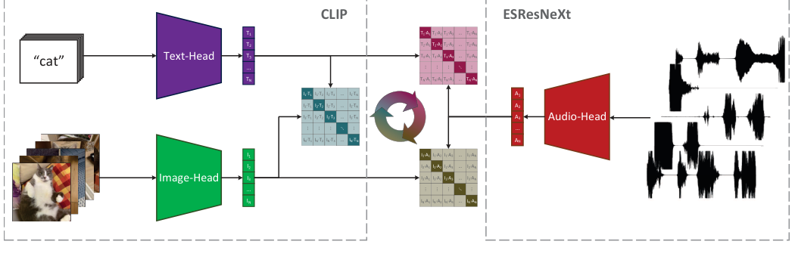

原 Figure 1，所下载公开正文第 3 页。ESResNeXt 音频编码器接入 CLIP 的图像与文本空间。

**损失与优化目标**

以模态对之间的相似度矩阵进行对称交叉熵对齐。它学习跨模态语义一致性，不包含专门情绪回归或歌曲轨迹损失。

---

## [P12] Emotion-Based End-to-End Matching Between Image and Music in Valence-Arousal Space / IMEMNet（2020）

美国加州大学伯克利分校、中国人民大学、南开大学、天津大学和滴滴研究团队合作，发表于 ACM MM 2020（CCF A 类会议，多媒体领域的高水平国际会议）。

**研究内容**

作者要解决图像与音乐内容语义不同、但可能表达相近情绪的跨模态匹配问题。IMEMNet 汇集 IAPS、NAPS 和 EMOTIC 的 25,620 张带情绪标签图像，将 DEAM 的 1,802 首音乐切成 23,944 个两秒片段，并采样形成 144,435 个图像—音乐对；监督包含连续 VA 坐标和由 VA 关系构造的匹配分数。作者借鉴跨模态度量学习，提出 CDCML，在共享空间中同时维持图像—音乐的情绪关系和单模态 VA 关系，以降低仅学习跨模态相似度时丢失各自情绪结构的问题。

**方法与架构**

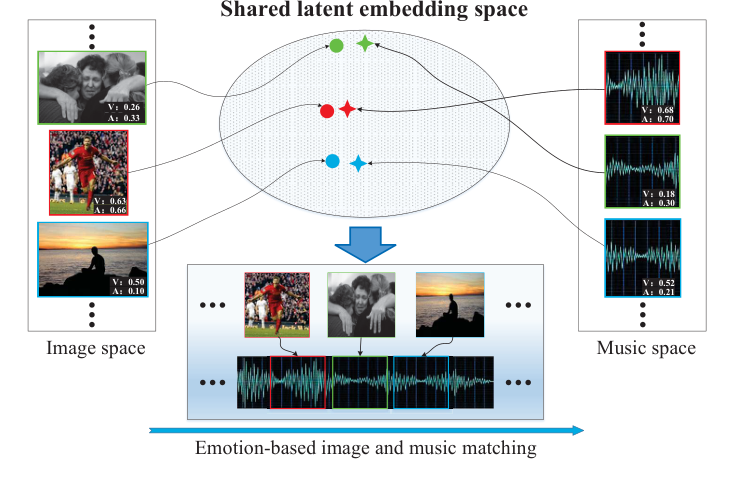

Figure 1：image 和 music 被投影到共享 latent embedding space；该空间同时保留 cross-modal emotion relationship 和 single-modal VA relationship。

*原 Figure 2：CDCML 完整方法架构。*

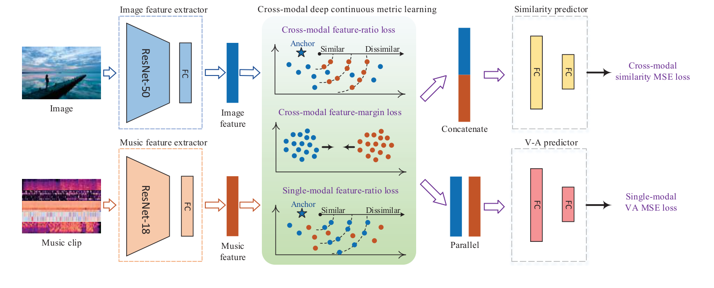

图像与音乐分别经编码器提取表示；CDCML 学习跨模态情绪度量，同时保留单模态 VA 回归，并输出图像—音乐相似度。

**损失与优化目标**

原文将损失分成 similarity family 和 VA family，包括 cross-modal feature relationship、cross-modal feature mapping、similarity prediction 以及单模态 VA regression。

单模态 VA 回归为：

$$
\mathcal{L}_{I\mathrm{VA}}
=\frac{1}{m}\sum_{i=1}^{m}
\left(y^{I_i}-\hat y^{I_i}\right)^2,
$$

$$
\mathcal{L}_{M\mathrm{VA}}
=\frac{1}{m}\sum_{j=1}^{m}
\left(y^{M_j}-\hat y^{M_j}\right)^2.
$$

相似度相关损失学习图像—音乐匹配，VA 回归项保持各自的情绪结构。CFR、CFM、Sim 的完整逐项公式尚未转录，这里保留已核验的总目标与 VA 项。
