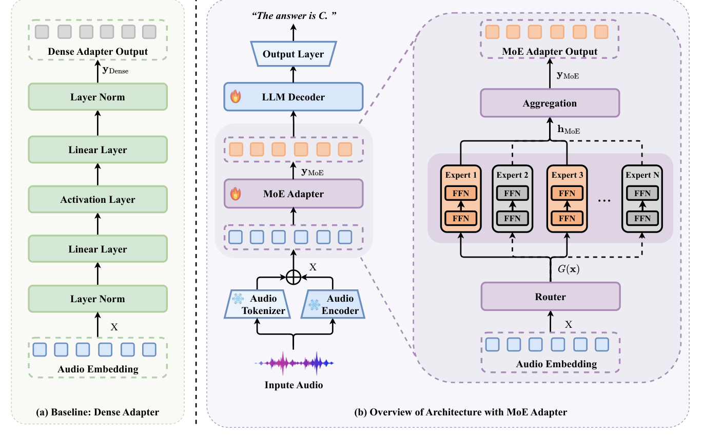
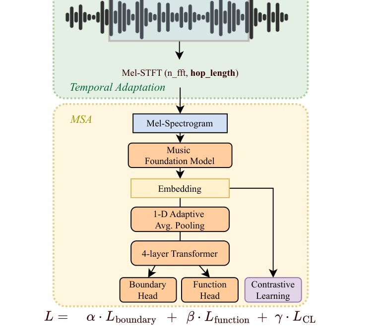
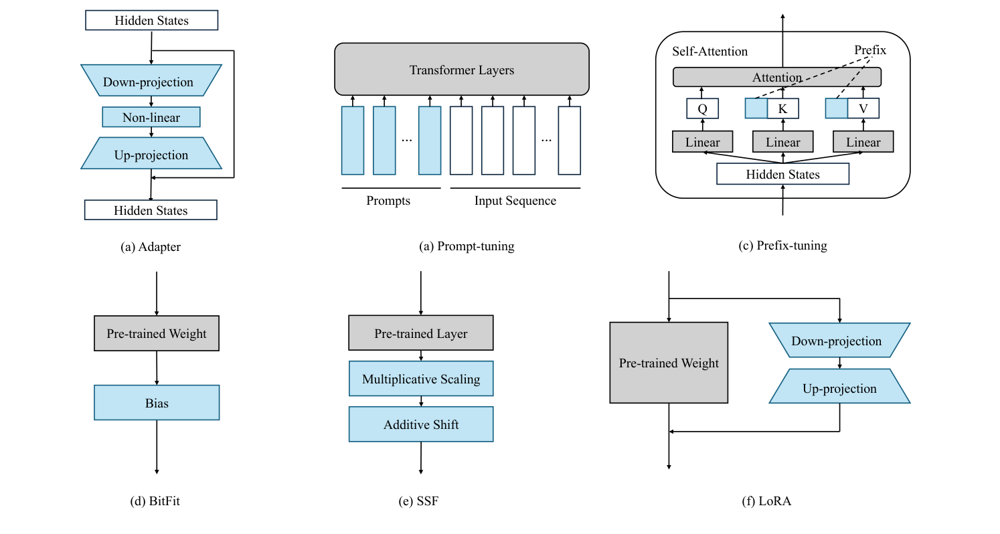
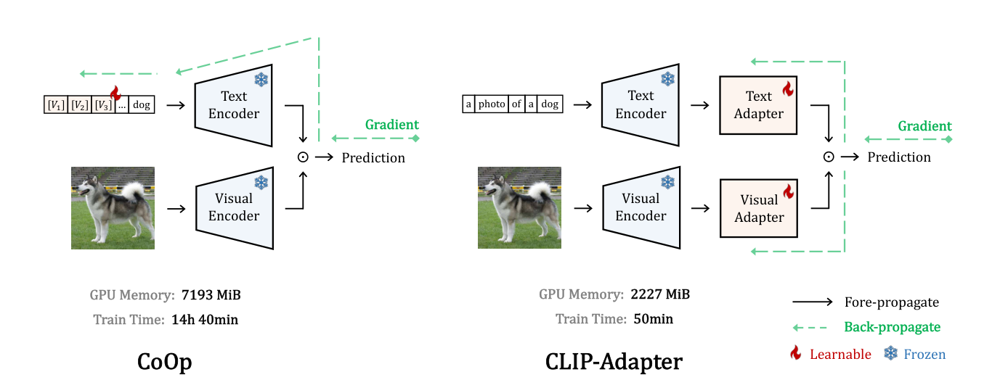
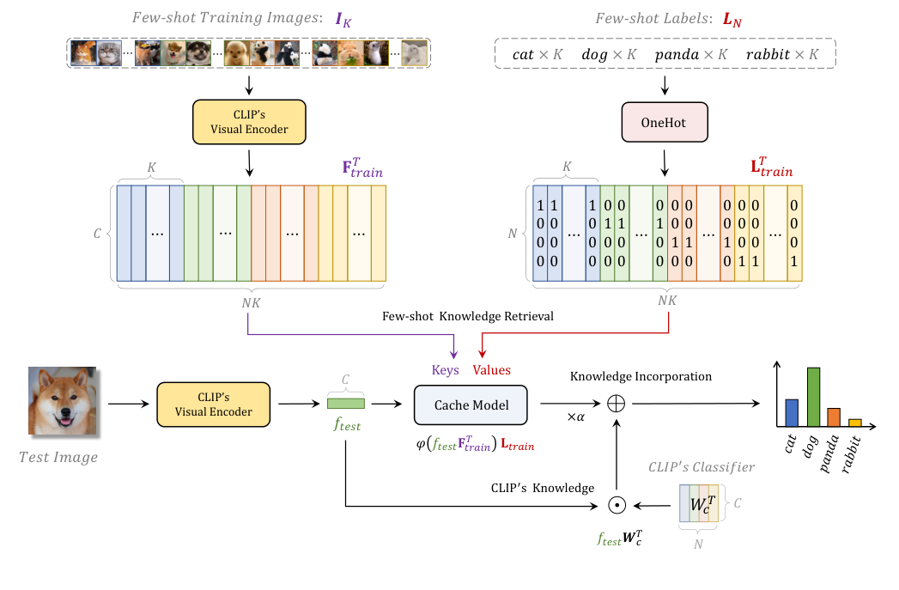
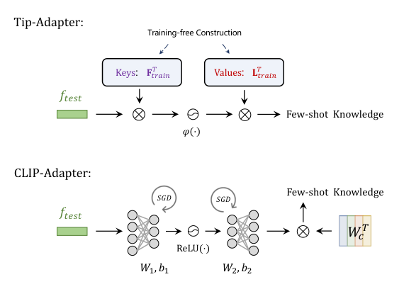
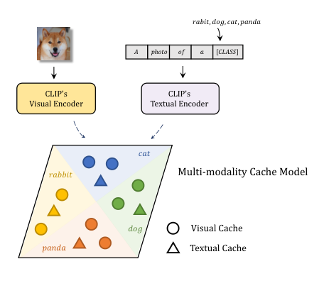
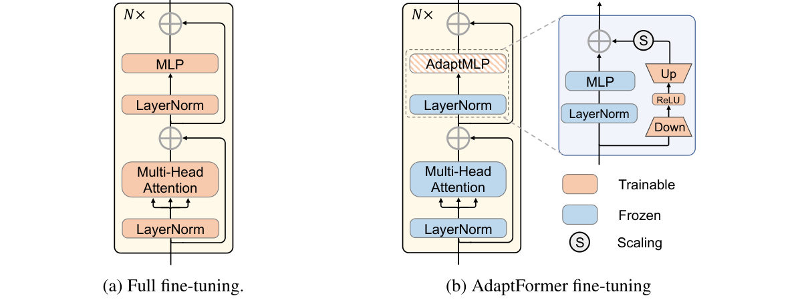
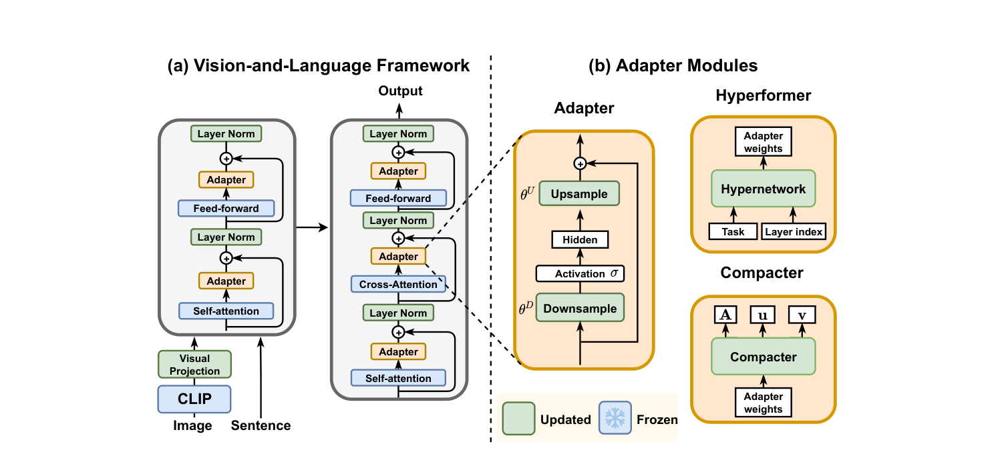

# 轻量适配与多因素建模

**任务现状综述**

任务说明：让同一首歌的表示能够分别服务于语义匹配、情绪匹配和偏好匹配，并研究这些因素如何共同参与评分。现有残差适配、参数高效迁移和音频变体文献保留在这一类；当前项目的多头结构按任务因素分工理解。

---

## [P01] MoE Adapter for Large Audio Language Models: Sparsity, Disentanglement, and Gradient-Conflict-Free（2026）

百度 ERNIE 团队、清华大学深圳国际研究生院和内蒙古大学等团队合作，公开为 [2026 年 arXiv 预印本](https://arxiv.org/abs/2601.02967)。

**研究内容**

作者针对语音、环境声和音乐共用一个稠密音频适配器时，不同任务梯度互相干扰的问题，提出稀疏混合专家适配器。模型使用 Whisper 音频表示、离散音频信息和 Qwen3 语言模型，训练语料包含语音、音乐与环境声音，并在含音乐问题的 MMAU 等音频理解基准上评价。作者借鉴混合专家路由，让不同输入激活不同专家，再聚合到语言模型空间，以降低共享适配器中的冲突。正文比较中总适配器参数约 94.4M，推理激活约 70.8M，因此“稀疏”指每次激活的参数更少；论文并未证明专家对应明确的语义、情绪和偏好三个因素。

**方法与架构**

*原 Figure 2：稠密适配器与 MoE 音频适配器。*

路由器为音频表示选择专家，专家输出聚合后输入语言模型。图中把音频前端、适配器和语言模型的位置完整保留。

**损失与优化目标**

训练以答案序列的下一词预测为主，并加入专家负载均衡辅助项：

$$
\mathcal L=\mathcal L_{\mathrm{NTP}}+\lambda\mathcal L_{\mathrm{aux}}.
$$

主项学习音频条件下的答案，辅助项减少专家使用过度集中。这里的因素分离来自路由与训练行为，原文没有提供显式的 S/A/P 解耦损失。

---

## [P02] Temporal Adaptation of Pre-trained Foundation Models for Music Structure Analysis（WASPAA 2025）

字节跳动音乐研究团队提出，[发表于 WASPAA 2025](https://arxiv.org/abs/2507.13572)。WASPAA 是 IEEE 音频与声学信号处理领域的专业学术研讨会，未按 CCF 主会 A/B/C 类标注。

**研究内容**

作者针对音乐基础模型通常处理短片段、直接用于整曲结构分析时计算量大且边界分辨率不匹配的问题，提出时间适配方法。实验使用 Harmonix 的 912 首歌曲和 RWC-Pop 的 100 首歌曲，数据是整曲音频及段落起止、主歌或副歌等功能标注。作者通过调整波形分析窗和跳步、降低表示的时间密度，再用轻量 Transformer 同时预测结构边界与段落功能，并让相同功能的片段表示更接近。创新是把预训练音乐表示适配到整曲时序分析，为理解相邻歌曲或段落的过渡提供结构信息；原文实验也涉及基础模型微调。

**方法与架构**

*原 Figure 1：时间适配与音乐结构分析框架。*

正文 PDF 第 1 页。上方调整 Mel-STFT 的时间参数，下方接音乐基础模型、时间池化和四层 Transformer，再分成边界、功能和对比学习分支。

**损失与优化目标**

训练组合边界损失、段落功能损失和表示对比损失，并对损失尺度进行归一化。边界项包含加权二元交叉熵、平滑 L1 与焦点损失，功能项使用加权二元交叉熵；对比项约束结构相近的片段表示。原文组合系数分别为 0.1、0.9 和 0.1，不能把它简化成只有边界分类的单一目标。

---

## [P03] Parameter-Efficient Transfer Learning for Music Foundation Models（2024）

美国佐治亚理工学院音乐信息研究团队与德国维尔茨堡大学人工智能与数据科学中心合作，公开为 [2024 年 arXiv 预印本](https://arxiv.org/abs/2411.19371)。

**研究内容**

作者研究在训练资源有限时，音乐基础模型是否可以通过少量参数更新适配不同音乐任务。实验以 MusicFM、MERT 为基础模型，使用 MagnaTagATune 和 MTG-Jamendo 的音频—多标签数据、GTZAN 的流派数据，以及 GiantSteps、GTZAN 的调性和速度标注。作者系统比较 Adapter、提示微调、前缀微调、BitFit、SSF 和 LoRA，在冻结大部分预训练参数的情况下更新小模块或指定参数。创新在于给出音乐领域的适配位置、任务效果和资源消耗对照，而不是重新训练一个通用大模型。

**方法与架构**

*原 Figure 1：六种参数高效迁移方法。*

原图并列展示瓶颈适配器、提示、前缀、偏置更新、缩放平移和低秩更新，可以直接看出它们改动网络的具体位置。

**损失与优化目标**

各方法沿用对应下游任务的监督训练目标，比较重点是哪些参数参与更新以及效果与开销。本文没有提出适用于所有任务的新统一损失，不能将 LoRA 的低秩参数化本身当成损失函数。

---

## [P04] CLIP-Adapter: Better Vision-Language Models with Feature Adapters（IJCV 2024）

上海人工智能实验室、香港中文大学和美国罗格斯大学团队合作，正式发表于 2024 年《International Journal of Computer Vision》（IJCV，CCF A 类期刊，计算机视觉领域的高水平期刊）；

**研究内容**

作者针对 CLIP 在新任务上直接使用零样本分类不够准确、全量微调又容易破坏预训练知识的问题，使用 ImageNet、Caltech101、OxfordPets、StanfordCars、Flowers102、Food101、FGVCAircraft、SUN397、DTD、EuroSAT 和 UCF101 共 11 个分类基准。数据形式是图像或动作视频类别对应的样本和类别名称，实验每类只提供 1、2、4、8 或 16 个标注样本。作者借鉴瓶颈适配器，在冻结的 CLIP 特征后增加小型网络，并用残差比例混合原始特征与适配特征，以少量参数吸收新任务知识。

**方法与架构**

**Figure 1**：对比 CoOp 与 CLIP-Adapter。CLIP-Adapter 在 CLIP 的视觉或文本编码器输出后接轻量 residual-style adapter；训练时不对 CLIP encoder 反向传播。

**损失与优化目标**

视觉和文本 adapter 形式为：

$$
A_v(f)=\operatorname{ReLU}(f^{\mathsf T}W_1^v)W_2^v,
$$

$$
A_t(W)=\operatorname{ReLU}(W^{\mathsf T}W_1^t)W_2^t.
$$

残差融合为：

$$
 f^{\star}=\alpha A_v(f)^{\mathsf T}+(1-\alpha)f,
$$

$$
 W^{\star}=\beta A_t(W)^{\mathsf T}+(1-\beta)W.
$$

分类概率为：

$$
 p_i=\frac{\exp(W_i^{\mathsf T}f/\tau)}{\sum_{j=1}^{K}\exp(W_j^{\mathsf T}f/\tau)}.
$$

训练使用下游分类的交叉熵，只更新轻量适配器等少量参数。残差比例控制原始特征与新任务特征的融合，上面的适配器和分类概率公式描述计算过程，不是另外的损失项。

---

## [P05] Tip-Adapter: Training-free Adaptation of CLIP for Few-shot Classification（ECCV 2022）

上海人工智能实验室、香港中文大学和商汤等团队合作，发表于 ECCV 2022（CCF B 类会议，计算机视觉领域的重要国际会议）。

**研究内容**

作者希望在少量标注样本下快速适配 CLIP，同时降低训练成本。实验使用 ImageNet、Caltech101 等 11 个图像分类基准，每类给出少量图像和类别标签，类别文字由 CLIP 文本编码器生成表示。作者借鉴检索缓存，将训练图像特征作为键、类别的独热标签作为值；测试时把样本与缓存的相似度转成类别分数，再与原始 CLIP 分数融合。其改进是无需训练就能利用下游样本，Tip-Adapter-F 则进一步用少量训练微调缓存键。

**方法与架构**

**Figure 1**：CLIP-Adapter 与 Tip-Adapter 对比。Tip-Adapter 使用 few-shot 特征构造 cache model。

以上 Figure 1–3 已从 Tip-Adapter 原论文 HTML 资源核验。

**损失与优化目标**

cache 相似度为：

$$
A=\exp\left[-\beta\left(1-f_{\mathrm{test}}F_{\mathrm{train}}^{\mathsf T}\right)\right].
$$

最终 logits 为：

$$
\mathrm{logits}=\alpha A L_{\mathrm{train}}+f_{\mathrm{test}}W_c^{\mathsf T}.
$$

其中 $F_{\mathrm{train}}$ 是 few-shot keys，$L_{\mathrm{train}}$ 是 labels，$W_c$ 是类别文本特征。Tip-Adapter-F 使用交叉熵微调 cache keys。

原论文解释：cache 直接存储下游 few-shot 知识，避免从零训练；Tip-Adapter-F 在此基础上快速调整 keys。

---

## [P06] AdaptFormer: Adapting Vision Transformers for Scalable Visual Recognition（NeurIPS 2022）

香港大学和腾讯 AI Lab 团队合作，发表于 NeurIPS 2022（CCF A 类会议，机器学习领域的高水平国际会议）。

**研究内容**

作者希望把预训练视觉 Transformer 迁移到新任务时，只更新少量参数。实验使用 CIFAR-100、SVHN、Food-101 等带类别标签的图像数据，以及 Something-Something V2、HMDB51 等带动作类别的视频片段，比较图像与视频分类中的迁移效果。作者借鉴瓶颈适配器，在 Transformer 层内设置与原前馈网络并行的 down–ReLU–up 分支，冻结主干并通过缩放残差注入任务信息。改进重点是同一种轻量结构能适配图像和视频，并减少全量微调的参数与存储成本。

**方法与架构**

原 Figure 2，PDF 第 4 页。Transformer MLP 旁增加 down projection → ReLU → up projection 分支，并以缩放系数接回原路径。

**损失与优化目标**

训练使用下游图像或视频类别的分类监督，只更新适配分支等少量参数。目标是提升新任务的分类准确率；论文的主要贡献在适配器结构与更新位置。

---

## [P07] VL-Adapter: Parameter-Efficient Transfer Learning for Vision-and-Language Tasks（CVPR 2022）

美国北卡罗来纳大学教堂山分校团队提出，发表于 CVPR 2022（CCF A 类会议，计算机视觉领域的高水平国际会议）。

**研究内容**

作者针对视觉—语言模型多任务微调时参数重复存储、不同任务适配难以共享的问题，使用 VQAv2、GQA、NLVR2 和 MSCOCO 的图像—文本样本，以及 TVQA、How2QA、TVC、YC2C 的视频—文本样本，涵盖问答、推理和描述生成。作者借鉴轻量适配器与文本生成式统一任务接口，把答案、类别或描述都转换为输出文字，并比较任务独立与任务共享的适配器。改进重点是在冻结大部分参数的同时，通过适配器共享处理多种视觉—语言任务。

**方法与架构**

图中区分冻结参数与更新参数，并比较 Adapter、Hyperformer 和 Compacter。

**损失与优化目标**

使用输出文字 token 的交叉熵，让模型正确生成答案、类别名称或描述。不同任务共享文本输出接口，适配器的独立或共享方式决定任务知识如何保存。
