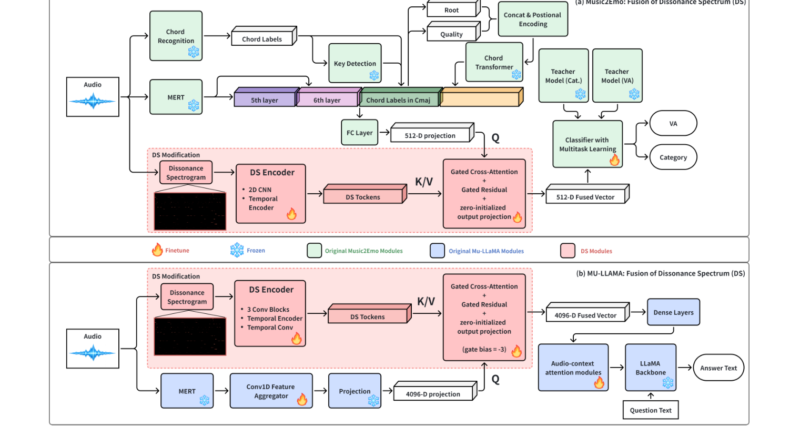
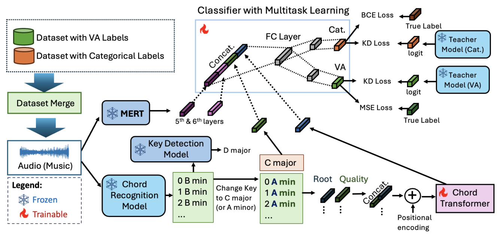
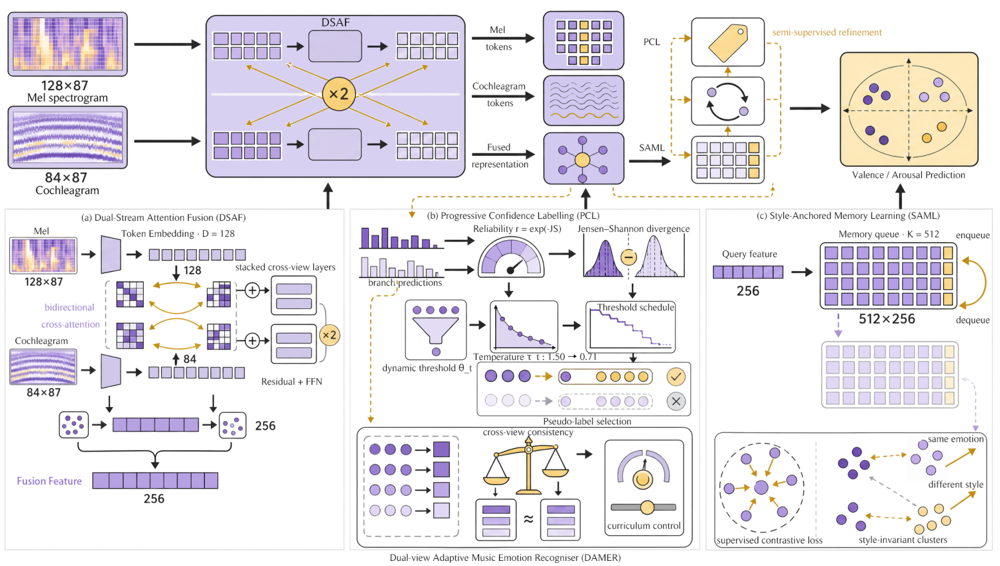
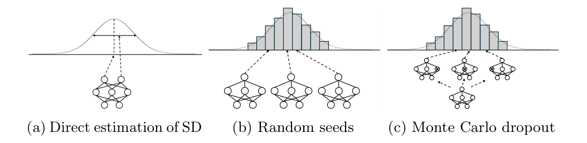
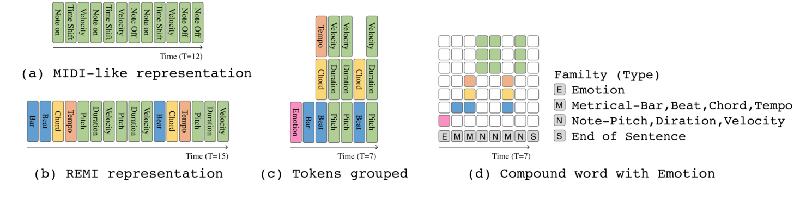
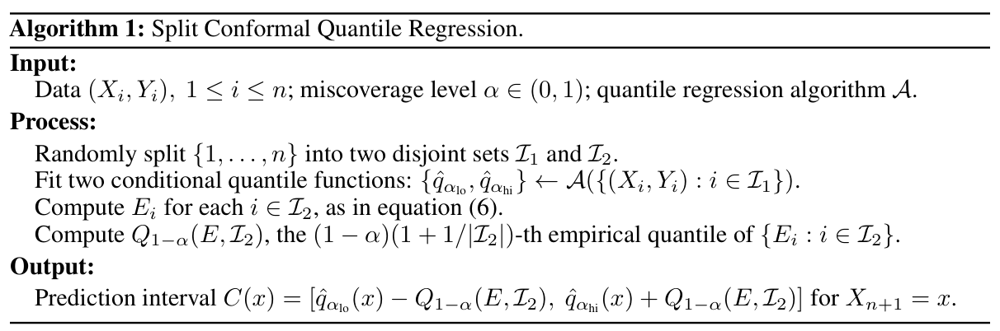
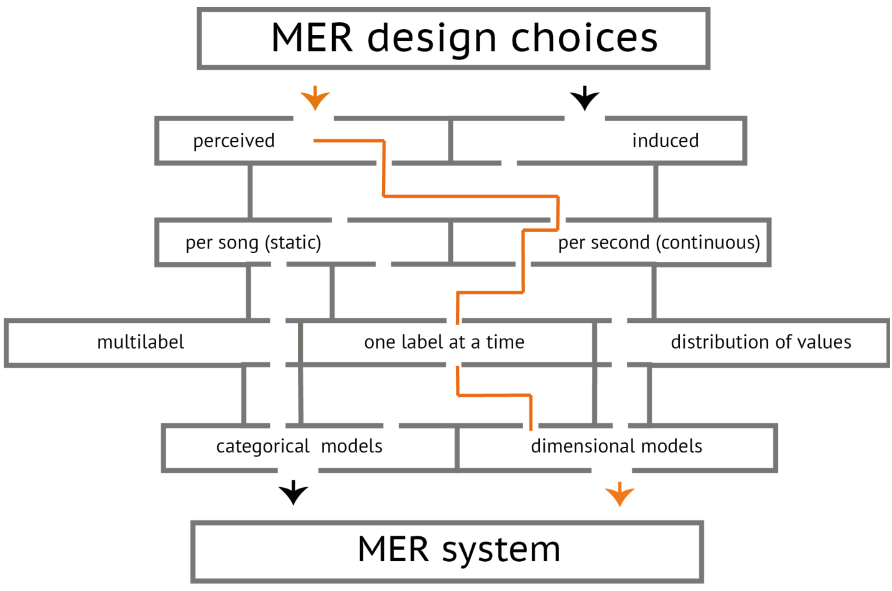
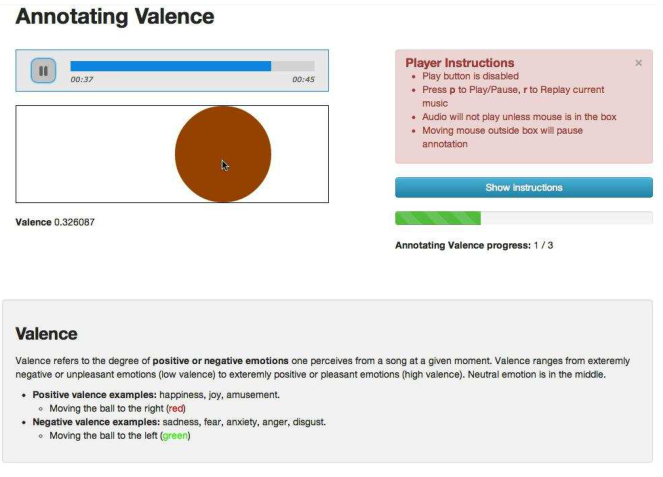
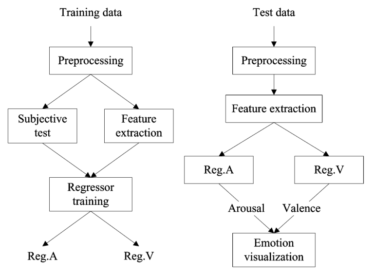

# 音乐情绪预测与不确定性校准

**任务现状综述**

任务说明：回答每首歌曲的效价（Valence）和唤醒度（Arousal）如何预测，以及预测值的可靠范围如何估计。音乐情绪识别文献提供音频特征、监督数据与连续情绪建模基础；分位数回归与共形校准文献覆盖当前项目从单点 VA 预测到上下界及校准区间的处理。

---

## [P01] Dissonance Spectrum explicitly models perceptual frequency interactions for better music understanding（2026）

北京通用人工智能研究院（BIGAI）、中央音乐学院和北京大学等团队合作，作者包括朱松纯，公开为 [2026 年 arXiv 预印本](https://arxiv.org/abs/2608.25621)。

**研究内容**

作者针对现有音乐表示对音高之间的协和与不协和关系建模不足的问题，提出 Dissonance Spectrum。实验在 MTG-Jamendo 的音频—音乐标签以及 DEAM、EmoMusic、PMEmo 的音频—连续 VA 标注上检验情绪回归，并扩展到音乐问答。方法根据频率比、音高关系和幅度计算感知不协和表示，再通过轻量编码器、交叉注意力和门控残差注入 Music2Emo 或 MU-LLaMA。创新是为已有表示补充可解释的频率交互，而不是替换全部主干；其情绪实验直接涉及当前使用的连续 VA 数据。

**方法与架构**

*原 Figure 4：DS 接入 Music2Emo 与 MU-LLaMA。*

红色部分是新增 DS 分支，上半图用于标签与 VA 输出，下半图用于音乐问答。零初始化与门控残差让训练起点保留原模型行为。

**损失与优化目标**

Music2Emo 实验沿用原模型的标签加权二元交叉熵、VA 均方误差和知识蒸馏目标；问答实验沿用答案生成目标。DS 分支没有另设情绪校准损失，因此该论文提供的是情绪表示改进证据，不能据此声称预测区间具有覆盖率保证。

---

## [P02] Towards Unified Music Emotion Recognition across Dimensional and Categorical Models（2025 预印本／ICPR 2026 接收）

新加坡科技设计大学团队的工作，2025 年公开预印本；作者主页已注明获 ICPR 2026 接收。ICPR 是模式识别国际会议，按 CCF 2026 目录为 C 类，当前正文采用公开预印本版本。

**研究内容**

作者要解决音乐情绪数据规模小、标签体系不一致的问题：MTG-Jamendo 的实验子集包含 18,486 首音频及 56 个 mood/theme 多标签，DEAM、PMEmo 和 EmoMusic 分别约有 1,802、794 和 744 首音乐，提供连续愉悦度（valence）与唤醒度（arousal）标注，本文使用其歌曲级静态 VA。作者借鉴 MERT 音频表示，并加入和弦进行与调性信息，同时设置情绪多标签分类和连续 VA 回归分支，再通过教师—学生知识蒸馏传递跨数据集知识。改进重点是让异构情绪标签共同参与训练，同时兼顾类别情绪与连续坐标。

**方法与架构**

图中包含 MERT audio embedding、chord progression、musical key、Transformer/FNN、categorical emotion branch、continuous VA regression branch 和 teacher-student knowledge distillation。

**损失与优化目标**

加权多标签 BCE：

$$
\mathcal{L}_{\mathrm{Cat}}(x,y)
=-\frac{1}{c}\sum_{i=1}^{c}
\left[
 w_i y_i\log x_i
 +\bar w_i(1-y_i)\log(1-x_i)
\right].
$$

VA MSE：

$$
\mathcal{L}_{\mathrm{VA}}(x,y)
=(y_v-x_v)^2+(y_a-x_a)^2.
$$

知识蒸馏 KL loss：

$$
\mathcal{L}_{\mathrm{KD}}(s,t)
=\sum_{i=1}^{c}t_i\log\frac{t_i}{s_i}.
$$

总损失分 categorical 与 VA 两种形式：

$$
\mathcal{L}_{\mathrm{Total,Cat}}
=\alpha\mathcal{L}_{\mathrm{Cat}}
+(1-\alpha)\mathcal{L}_{\mathrm{KD,Cat}},
$$

$$
\mathcal{L}_{\mathrm{Total,VA}}
=\beta\mathcal{L}_{\mathrm{VA}}
+(1-\beta)\mathcal{L}_{\mathrm{KD,VA}}.
$$

原论文解释：BCE 处理多标签不平衡；VA-MSE 拟合连续情绪；KD 通过 teacher soft targets 跨数据集传递知识、减轻任务冲突。

---

## [P03] Memo2496: Expert-Annotated Dataset and Dual-View Adaptive Framework for Music Emotion Recognition

华南理工大学、清华大学和琶洲实验室团队的工作，当前读取的是 2026 年修订的 arXiv 正文。正文采用《IEEE Transactions on Affective Computing》（CCF B 类期刊）的排版，但本次未核验正式发表的卷期信息，不据排版认定已发表。

**研究内容**

作者针对专家标注不足和不同曲目声学表现差异大的问题，建立 Memo2496：2,496 首器乐曲由 30 名音乐专家提供连续 VA 标注，并与 PMEmo、1000songs 比较。当前正文的主要实验将情绪转成二分类以统一跨数据集评价，另有连续回归实验，不能把所有结果都视为连续 VA 回归。作者借鉴双视图注意力、置信伪标签和带标签的对比记忆队列，分别用 Mel 频谱与耳蜗谱补充信息、筛选可靠未标注样本、聚合同情绪表示；记忆模块没有显式风格标签监督。

**方法与架构**

*原 Figure 2：DAMER 双视图自适应架构（当前修订版）。*

同一音频形成 Mel 频谱和耳蜗谱两种输入。DSAF 用双向交叉注意力交换细节，PCL 根据置信度和分支一致性选择伪标签，SAML 用带情绪标签的记忆队列聚合相近表示；Mel、耳蜗谱和融合分支分别输出分类预测。

**损失与优化目标**

当前修订正文的主要分类目标为：

$$
\mathcal L_{\mathrm{total}}
=\lambda_1\mathcal L_{\mathrm{cls}}
+\lambda_2\mathcal L_{\mathrm{PL}}
+\lambda_3\mathcal L_{\mathrm{consistency}}
+\lambda_4\mathcal L_{\mathrm{cont}}.
$$

$\mathcal L_{\mathrm{cls}}$ 汇总 Mel、耳蜗谱及融合预测头的交叉熵；$\mathcal L_{\mathrm{PL}}$ 让筛选出的伪标签监督耳蜗谱分支；$\mathcal L_{\mathrm{consistency}}$ 用 Jensen–Shannon 散度约束两分支一致；$\mathcal L_{\mathrm{cont}}$ 利用带标签记忆队列聚合同情绪表示。$\lambda_1$ 到 $\lambda_4$ 调节各项权重。

伪标签损失与筛选阈值为：

$$
\mathcal L_{\mathrm{PL}}
=\frac{1}{|D_{\mathrm{PL}}|}\sum_{i\in D_{\mathrm{PL}}}
r_i\,\mathrm{CE}(z_i^{\mathrm{Coch}},\hat y_i),
\qquad
\theta_t=\theta_0-(\theta_0-\theta_{\min})\frac{t}{T}.
$$

$D_{\mathrm{PL}}$ 为可信样本集合，$r_i$ 衡量两分支预测一致程度，$\hat y_i$ 是伪类别；阈值随训练下降，逐步增加可使用的样本。

记忆队列对比目标为：

$$
\mathcal L_{\mathrm{cont}}
=-\frac{1}{N_q}\sum_{i=1}^{N_q}
\log\frac{\sum_{j\in P_i}\exp(q_i^{\mathsf T}k_j/\tau_{\mathrm{cont}})+\epsilon}
{\sum_{k=1}^{K}\exp(q_i^{\mathsf T}k_k/\tau_{\mathrm{cont}})+\epsilon}.
$$

$q_i$ 是当前样本表示，$k_j$ 是队列中的表示，$P_i$ 收集同情绪标签的正样本，$\tau_{\mathrm{cont}}$ 是温度，$\epsilon$ 保证数值稳定。正文另做的连续 VA 回归实验使用 Huber loss，与这里的主分类目标分开。

---

## [P04] Uncertainty Estimation in the Real World: A Study on Music Emotion Recognition（ECIR 2025）

美国佐治亚理工学院与德国维尔茨堡大学团队合作，[发表于 ECIR 2025](https://www.alexanderlerch.com/posts/paper-uncertainty/)。ECIR 是欧洲信息检索国际会议，属于 CCF C 类。

**研究内容**

作者针对音乐情绪具有主观性、模型不确定性是否能反映听众分歧的问题，比较直接预测标注分布、不同随机种子集成和 Monte Carlo Dropout。实验使用 DEAM 中 1,744 个 45 秒音频片段，每段有多位标注者的 VA 评分，以评分均值与标准差描述人群情绪分布；不是只学习每首歌的一个平均标签。作者把主观标注差异与模型自身波动分开比较，发现均值预测容易优于不确定性预测，重复训练或 Dropout 的波动不能自然等同于听众分歧。创新在于审查音乐情绪区间背后的含义。

**方法与架构**

*原 Figure 1：三类不确定性估计方法示意。*

左侧直接估计标准差，中间重复随机种子训练，右侧在推理时启用 Dropout。原图是方法示意，完整保留三种方式。

**损失与优化目标**

原文比较分布参数的 MSE、KL 散度、高斯负对数似然，以及随机种子和 Dropout 方法。其中式（1）为：

$$
\mathcal L_{\mathrm{MSE}}=(\hat\mu-\mu)^2+(\hat\sigma^2-\sigma^2)^2.
$$

它同时拟合标注均值与方差。论文没有采用共形校准，也没有给出有限样本区间覆盖率保证。

---

## [P05] EMOPIA: A Multi-Modal Pop Piano Dataset For Emotion Recognition and Emotion-based Music Generation（ISMIR 2021）

台湾中央研究院、台湾大学、韩国科学技术院和美国佐治亚理工学院团队合作，发表于 ISMIR 2021。ISMIR 是音乐信息检索领域的主要国际会议，CCF 2026 目录未收录。

**研究内容**

作者希望同时支持音频与符号音乐的情绪识别，以及按情绪生成钢琴音乐。EMOPIA 从 387 首流行钢琴曲中整理出 1,087 个片段，每个片段具有音频、转录 MIDI 和专门标注者给出的情绪标签。标签是 VA 平面的四个象限，表示高低愉悦度与高低唤醒度组合，并非精确连续坐标。作者借鉴四象限情绪分类和自回归符号音乐生成，提供跨音频与 MIDI 的识别基线及情绪条件生成基线；主要创新是把两种音乐表示与统一片段级情绪标签放在同一基准中。

**方法与架构**

原 Figure 1，PDF 第 3 页。图示 MIDI-like、REMI、compound word 及 emotion token；这是输入表示图，不是新设计的完整模型架构。

**损失与优化目标**

情绪识别基线接受四象限类别监督；生成基线自回归预测音乐 token，使用负对数似然。前者学习片段所属情绪类别，后者学习在给定情绪条件下生成后续音符。

---

## [P06] Conformalized Quantile Regression（2019）

美国斯坦福大学统计系与数学系团队合作，发表于 NeurIPS 2019，属于 CCF A 类国际会议。

**研究内容**

作者研究的是“预测区间如何既可靠，又能随样本难度改变宽度”的问题：普通回归只给一个数，固定宽度区间又难以适应不同样本的误差大小。实验使用人工生成的异方差数据和 11 个表格回归基准，包括预测蛋白质三级结构性质的 bio 数据集；数据形式是输入特征向量与一个连续数值标签，并非音乐情绪数据。作者把分位数回归与共形预测结合起来，先学习上下分位数，再用独立校准集修正区间，创新在于同时适应局部误差大小和控制有限样本下的总体覆盖率。

**方法与架构**

*原 Algorithm 1：Split Conformal Quantile Regression 的完整方法流程。原文以算法框给出方法，而非神经网络架构图。*

数据分成模型训练集和校准集。训练集学习上下分位数函数；校准集计算每个真实标签距离区间边界的偏差，再据此确定统一的校准修正量，最后输出随输入变化的预测区间。

**损失与优化目标**

分位数回归使用原文的 pinball loss：

$$
\rho_\tau(u)=\max\{\tau u,(\tau-1)u\},\qquad u=y-\hat q_\tau(x).
$$

它对预测偏高与偏低施加不同惩罚，使模型学到指定分位数。原文随后在独立校准集上计算：

$$
E_i=\max\{\hat q_{\alpha_{\rm lo}}(X_i)-Y_i,\;Y_i-\hat q_{\alpha_{\rm hi}}(X_i)\},
\qquad
C(x)=[\hat q_{\alpha_{\rm lo}}(x)-Q,\;\hat q_{\alpha_{\rm hi}}(x)+Q].
$$

$Q$ 是校准分数的有限样本修正分位数。共形校准是训练后的区间修正步骤，不是再添加一个神经网络训练损失；原文的覆盖保证以样本可交换为前提，指总体边际覆盖，不直接保证每一种条件下或整段歌单同时覆盖。

---

## [P07] The PMEmo Dataset for Music Emotion Recognition（ICMR 2018）

浙江大学团队发布，数据集论文发表于 ICMR 2018（CCF B 类会议，主要研究多媒体检索）。

**研究内容**

作者希望为音乐情绪识别提供规模较大、能同时分析音频与生理反应的数据。PMEmo 包含 794 首流行歌曲的副歌片段，配有歌曲级静态 VA、随时间变化的动态 VA，以及听歌时同步记录的皮肤电活动（EDA）信号；官方资源还提供音频特征、歌曲元数据及歌词相关处理代码。作者借鉴主观情绪标注和生理信号采集方法，改进重点是把音乐内容、情绪评分与同步生理反应组织在同一数据集中，并提供静态和动态情绪识别基线。

**方法与架构**

本文围绕数据采集与基准构建：选择流行歌曲副歌片段，收集听众静态与动态 VA 评分，同时记录 EDA，整理音频特征并建立情绪预测基线。原始图件尚待从正文核验，不用自绘图冒充原图。

**损失与优化目标**

数据集本身没有统一训练损失；静态与动态情绪识别基线分别学习 VA，音频与 EDA 的表示可以单独或联合用于预测。回归模型的训练目标与评价误差需要分开理解。

---

## [P08] DEAM: Developing a Benchmark for Emotional Analysis of Music（2017）

荷兰乌得勒支大学、台湾中央研究院和瑞士日内瓦大学团队合作，发表于 2017 年《PLOS ONE》（SCI 综合性开放获取期刊；本次未核验具体年度的 JCR 或中科院分区）。

**研究内容**

作者针对音乐情绪数据规模有限、标注协议和评价方式不统一的问题，建立 DEAM 基准。数据包含 1,802 首音乐，既有每首歌曲整体的静态 VA 评分，也有以 2 Hz 提供的动态 VA 时间序列；模型输入通常是音频波形或从音频提取的声学特征，输出是愉悦度和唤醒度。作者借鉴连续情绪标注和基准评测的方法，贡献重点是统一数据组织、检查标注可靠性，并同时支持歌曲级情绪预测和随时间变化的情绪追踪。

**方法与架构**

*原 Figure 1：音乐情绪分析的建模与数据表示选择。*

图中标出 DEAM 的设计选择：研究音乐被感知的情绪，同时处理歌曲级与逐时刻标注，采用连续维度表示。本文是数据与基准论文，图展示建模流程，没有新神经网络架构。

**损失与优化目标**

数据集构建没有统一的神经网络训练损失；正文比较不同特征与回归方法的情绪预测效果，并检查标注可靠性。具体基线各有训练目标，不能把整个 DEAM 数据集定义为一个 MSE 模型。

---

## [P09] EmoMusic／Emotion in Music Dataset（MediaEval／CrowdMM 2013）

伦敦帝国理工学院、美国德雷塞尔大学、台湾大学和台湾中央研究院团队合作，相关采集论文发表于 CrowdMM 2013 工作坊，并用于 MediaEval 2013 音乐情绪评测。工作坊不直接套用主会的 CCF 等级。

**研究内容**

作者要解决的是缺少公开音乐情绪时间序列和可比较基线的问题。EmoMusic 又称 Emotion in Music／1000 songs，最初从 Free Music Archive 选取 1,000 首歌曲，清理重复后保留 744 首，官方划分为 619 首开发集和 125 首评测集。每首提供 45 秒音频片段、整体 VA 评分及动态 VA 标注；动态标注整理为 2 Hz 的均值和标准差，并剔除开头不稳定的标注。作者借鉴众包连续标注，让听众在播放过程中移动滑块，再配合歌曲级评分和回归基线，形成公开评测资源。

**方法与架构**

*原 Figure 1：动态情绪标注界面，展示数据采集方法。*

听众在播放音乐时移动滑块表达当前愉悦度或唤醒度，再对整段音乐给出静态评分。它是原始采集方法图，没有新神经网络架构；官方发布版对连续标注另作重采样与清理。

**损失与优化目标**

原始采集论文以多元线性回归作为基线，用整理后的静态或动态情绪均值作预测目标；数据发布与标注清理本身没有统一训练损失。后续论文的神经网络损失不是该数据集自带的方法。

---

## [P10] A Regression Approach to Music Emotion Recognition（IEEE TASLP 2008）

台湾大学团队提出，发表于 2008 年《IEEE Transactions on Audio, Speech, and Language Processing》（TASLP，按 CCF 2026 目录为 B 类期刊，音频与语音处理领域的重要期刊）。

**研究内容**

作者针对少量离散情绪类别难以表达音乐情绪细微变化的问题，自建 195 首西方、中文和日文流行歌曲数据，每首选取 25 秒代表片段。听众在 −1 到 1 的 11 级尺度上标注愉悦度与唤醒度，再对多人评分取均值，得到可回归的情绪坐标；输入是音频声学特征。作者借鉴连续情绪维度、特征选择和回归学习，比较多元线性回归、支持向量回归等模型，并在情绪平面检索音乐。其贡献是将音乐情绪识别直接表述为连续坐标预测，而非仅预测类别。

**方法与架构**

训练数据经预处理、音频特征提取与主观标注学习两个回归器，测试时输出 arousal/valence。

**损失与优化目标**

多元线性回归通过最小二乘拟合情绪坐标，支持向量回归采用其自身的回归目标，各模型训练方式不同。正文用回归误差与决定系数 R² 评价连续情绪坐标的预测质量。
