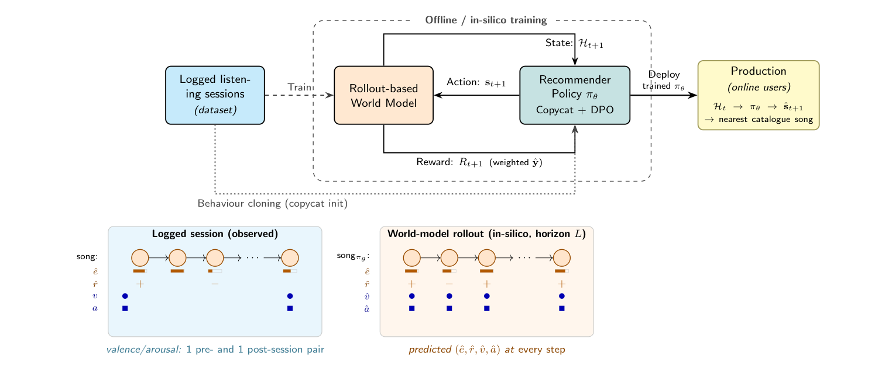
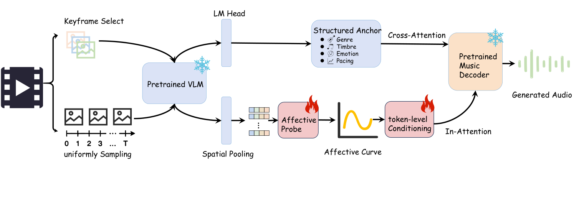
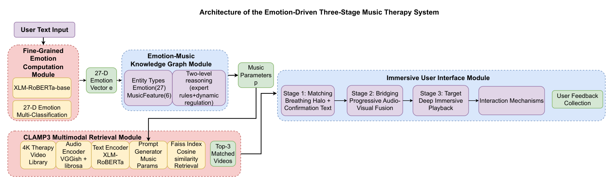
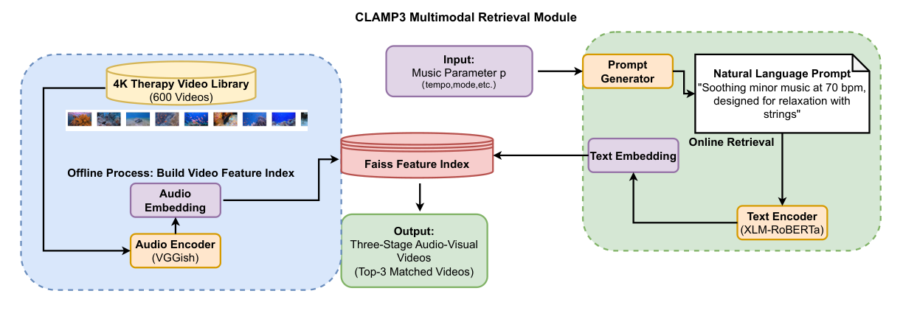
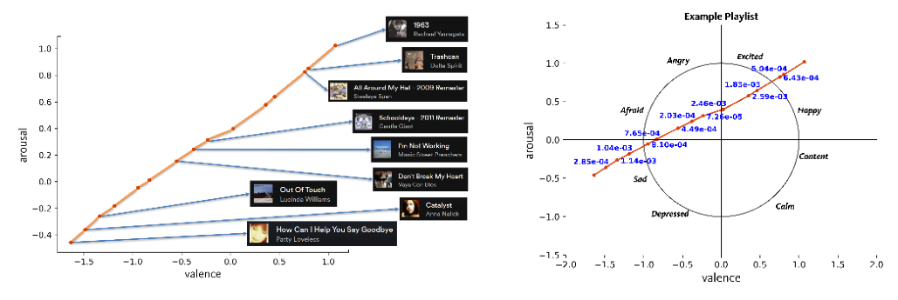
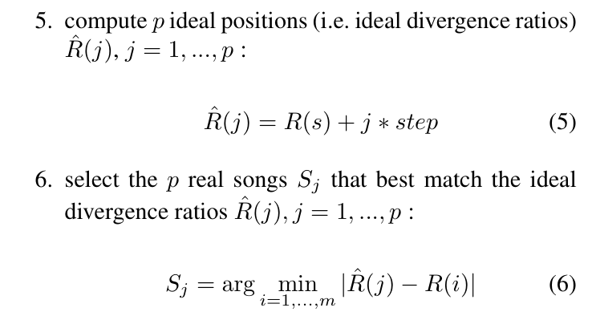

# 情绪轨迹与平滑过渡

**任务现状综述**

任务说明：“当前情绪—目标情绪”之间的过渡要求，关注歌单各位置应呈现什么情绪、相邻歌曲如何衔接，以及偏好怎样参与阶段性组织。它回答过渡目标和路径怎样定义，覆盖连续 VA 轨迹与分阶段情绪引导，独立于后续采用哪一种搜索算法。

---

## [P01] Affective Music Recommendation: A Rollout-Based World Model for Offline Preference Optimization（2026）

LUCID 音乐健康技术团队与加拿大 Mila 人工智能研究所合作，作者包括 Laurent Charlin 和 Guillaume Lajoie，公开为 [2026 年 arXiv 预印本](https://arxiv.org/abs/2605.28810)。尚无正式会议或期刊等级。

**研究内容**

作者要解决音乐情绪推荐的用户反馈稀疏、不能仅凭逐首评分优化后续整段体验的问题。数据来自 939 位用户的 8,784 次音乐会话、57,822 条交互，包含歌曲音频表示、收听比例、歌曲评价和会话前后的自报 VA；情绪标签主要出现在会话端点，并非每首歌曲都有用户 VA。作者借鉴世界模型，学习在给定历史与候选歌曲时预测后续行为及情绪，再从行为克隆策略出发，用离线偏好优化调整推荐序列。创新是将情绪和参与度共同纳入序列策略；报告的策略情绪收益主要来自离线模型预测。

**方法与架构**

*原 Figure 1：世界模型、离线偏好优化与推荐流程。*

生产系统记录稀疏真实反馈，世界模型产生模拟反馈与滚动预测，推荐策略先模仿历史行为，再依据模拟序列效用进行 DPO。

**损失与优化目标**

世界模型对收听比例、效价和唤醒度采用 MSE，对二元歌曲评价采用 BCE，并仅在对应标签被观测的位置计算监督；会话前 VA 作为输入，监督目标是会话后 VA。策略先以 InfoNCE 学习历史歌曲选择，再以 DPO 偏好目标比较较好与较差的模拟序列，同时约束相对参考策略的偏移。世界模型预测准确与策略效用改善需要分别评价。

---

## [P02] NarraScore: Bridging Visual Narrative and Musical Dynamics via Hierarchical Affective Control（2026）

清华大学与字节跳动团队合作，公开为 [2026 年 arXiv 预印本](https://arxiv.org/abs/2602.09070)。尚无正式会议或期刊等级。

**研究内容**

作者针对长视频配乐容易只匹配整体风格、跟不上叙事情绪变化的问题，提出全局语义与局部情绪轨迹双分支控制。训练使用带逐帧 VA 的电影片段和带逐秒 VA 的音乐片段或整曲；正文未明确写出两个数据集名称，但给出处理后约 884 分钟视频和 1,351 分钟音乐。方法冻结视觉语言与音乐生成主干，用轻量情绪探针提取连续 VA，经插值和时间适配器注入音乐解码过程，滑动窗口维持长段一致性。它提供“整体条件＋连续情绪路径”的方法设计，输出为新生成音频。

**方法与架构**

*原 Figure 2：NarraScore 分层情绪控制架构。*

全局分支形成风格语义，局部分支提取随时间变化的 VA，再经 Temporal Adapter 控制冻结音乐解码器。两个条件分支及生成输出完整保留。

**损失与优化目标**

情绪探针结合 VA 的 L2 与 L1 回归误差；音乐适配器沿用音频 token 的自回归交叉熵，正文式（7）为：

$$
\mathcal L_{\mathrm{gen}}=-\frac1{T_a}\sum_{t=1}^{T_a}\log p(a_t\mid a_{<t},S_{\mathrm{global}},C_{\mathrm{local}}).
$$

这里的局部 VA 是生成条件；该目标没有直接优化现有歌曲目录中的歌单选择，也没有验证听众会沿目标曲线改变情绪。

---

## [P03] ISO 原理与 LLM 特征估计的情绪迁移型音乐推荐系统（2026）

作者来自日本横滨国际学校，发表于日本人工智能学会 JSAI 2026 全国大会，属于国内学术大会论文，本次未核验 CCF 等级。

**研究内容**

作者希望把音乐治疗中的 ISO 原理转成日常可用的情绪迁移推荐：先匹配当前状态，再引导到目标状态。曲库有 1,368 首歌，其中 1,363 首获得有效估计；Gemini 根据曲名、艺人和专辑等文字元数据估计 15 个属性，以 energy 和 happiness 代理唤醒度与愉悦度，并非直接分析音频获得人工 VA 真值。作者借鉴 ISO 三阶段流程，将属性评分、歌词偏好与四种迁移路径结合。正文另用 20 首歌检查部分属性估计，并报告单人六次体验记录，创新主要在系统组合与阶段式选歌。

**方法与架构**

**逐页核验结果：正文没有独立的方法架构图，只有 Figure 1 应用界面。** 保留这张原图以便阅读系统交互，但不把它计入架构图补齐数量。

系统使用 Swift/SwiftUI 前端、Python/Flask 推荐服务及 Spotify 播放接口；方法在正文第 3 节以文字描述。

**损失与优化目标**

系统按规则为候选歌曲评分：energy 与 happiness 各权重 3，BPM 权重 2，vibe 关键词权重 1；歌词偏好通过 instrumentalness 阈值处理，权重 2。随后选择高分歌曲并控制阶段间重复。它没有训练端到端的连续 VA 回归器或轨迹损失。

---

## [P04] EmoHeal: An End-to-End System for Personalized Therapeutic Music Retrieval from Fine-Grained Emotions（2025）

英国伦敦玛丽女王大学团队提出，当前核验到的是 2025 年 arXiv 预印本。

**研究内容**

作者希望把用户用文字表达的细粒度情绪转成可检索的音乐条件，并组织从当前情绪逐步走向目标状态的体验。文本情绪识别使用 GoEmotions 的 27 类情绪标注，并将 NLPCC-2014 中文情绪数据映射到相应标签；检索库由 600 多个约 3 分钟的 4K 自然疗愈视频片段及其音轨组成，另有 40 人的系统体验评价。作者借鉴情绪—音乐知识规则和 CLaMP3 跨模态检索，将“文字情绪识别、音乐参数转换、内容检索、三阶段播放”串成完整系统；改进重点是 match–guide–target 的逐步引导，而非单次检索。

**方法与架构**

*原 Figure 1：整体架构。*

用户输入文字，情绪识别器得到细粒度情绪向量；知识规则将情绪转成速度、调式、音色等音乐参数，再交给检索模块选择内容。播放按“匹配当前状态 → 中间引导 → 目标状态”三个阶段组织。

*原 Figure 3：多模态检索模块。*

音乐参数先转成自然语言提示，再由文本编码器生成查询表示，在预建音轨索引中检索并返回视频片段。原文图中音轨索引标有 VGGish，因此这里按系统模块理解，不把它写成从头训练 CLaMP3。

情绪向量到音乐参数的计算为：

$$
\mathbf{p}=\sigma(\mathbf{e}W).
$$

其中 $\mathbf e$ 是情绪向量，$W$ 是规则权重，$\mathbf p$ 包含速度、调式、音色、和声、音区与密度；这是一项映射计算，不是损失函数。

**损失与优化目标**

文本情绪分类器使用 Focal Loss：

$$
\mathcal L_{\mathrm{cls}}=-\alpha_t(1-p_t)^\gamma\log(p_t).
$$

其中 $p_t$ 是真实类别的预测概率，$\alpha_t$ 调节类别权重，$\gamma$ 降低易分类样本的贡献，让训练更多关注难样本。正文给出该项用于文本情绪识别，没有给出整个检索与播放系统共同训练的总损失。

## [P06] Mood Dynamic Playlist: Interpolating a musical path between emotions using a KNN algorithm（IHIET-AI 2022）

美国俄勒冈州立大学团队提出，发表于 IHIET-AI 2022，属于人因与智能技术方向的国际会议；本次未核验对应 CCF 等级。

**研究内容**

作者要解决普通歌单只围绕一个情绪点选歌、难以从起始情绪逐步移动到目标情绪的问题。论文使用包含歌曲信息、音频分析特征及估计 VA 坐标的流行音乐曲库，样本单位是一首歌曲及其特征向量，坐标来自特征估计，并非新的人工情绪标注数据集。作者借鉴二维情绪空间中的线性插值，把起止点之间的理想直线分成多个位置，再利用 KNN 从曲库寻找相近歌曲，并比较不同距离度量。创新重点是将歌单生成转成沿情绪路径的逐位置选歌。

**方法与架构**

原 Figure 3，PDF 第 6 页。展示歌曲序列及其 VA 路径；这是方法实例图，不是神经网络架构图。

**损失与优化目标**

选歌使用 KNN 与路径位置匹配，没有端到端网络训练损失。论文用生成路径相对理想直线的 MSE 评价平滑性，并比较距离度量；在其数据与实验配置下 cosine 表现最好。

---

## [P07] Playlist Generation using Start and End Songs（ISMIR 2008）

奥地利人工智能研究所和约翰内斯开普勒大学团队合作，发表于 ISMIR 2008。ISMIR 是音乐信息检索领域的主要国际会议，CCF 2026 目录未收录。

**研究内容**

作者希望在用户指定起始歌曲和结束歌曲后，自动找到音频变化平滑的连接歌单。实验使用 FM4 Soundpark 的 2,566 首开发集歌曲及六类流派信息，从音频提取 MFCC，并用单个高斯分布表示每首歌曲的谱特征；流派主要用于评价，算法没有 VA 标签。作者借鉴高斯谱相似度与端点距离，把歌曲到起点、终点的距离关系转换成路径位置，再按位置选择中间歌曲。创新重点是同时约束两个端点，而不是仅按相邻相似度不断扩展。

**方法与架构**

逐页检查正文：没有独立编号的架构图。方法用分步算法和公式说明，下图是原始选歌公式截取，不标作 Figure。

先得到起止歌曲的距离比，再在该一维空间选择与理想等距位置最接近的歌曲。

**损失与优化目标**

方法通过高斯歌曲表示之间的 KL 型距离选择歌曲，属于路径匹配准则。正文定义 $R(i)=D_{KL}(i,s)/D_{KL}(i,e)$，其中 $s$ 和 $e$ 是起止歌曲，再按理想位置选择中间歌曲；这里没有神经网络训练损失。
