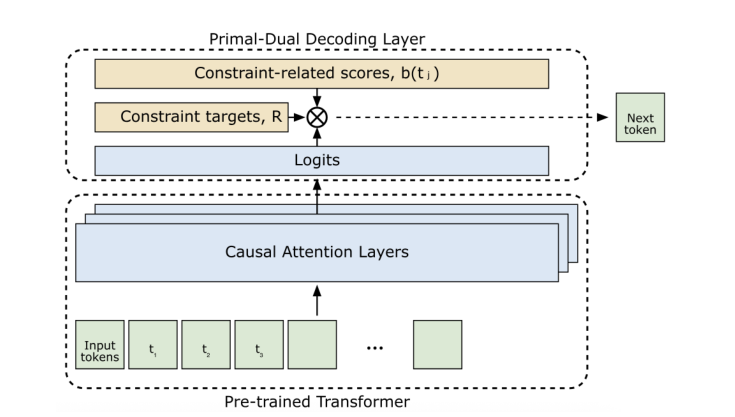
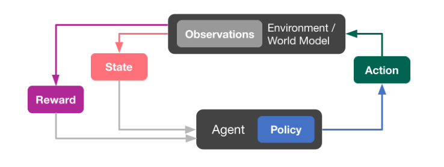
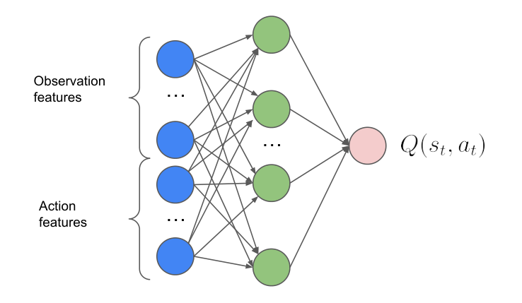
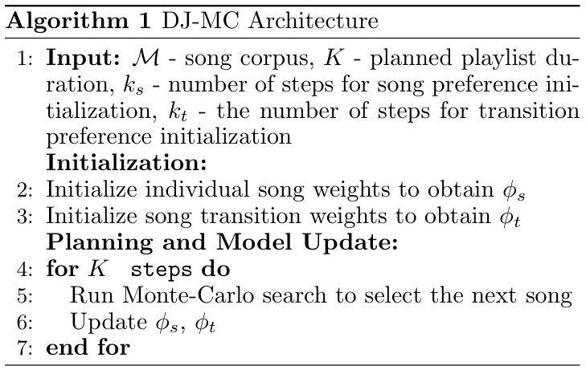
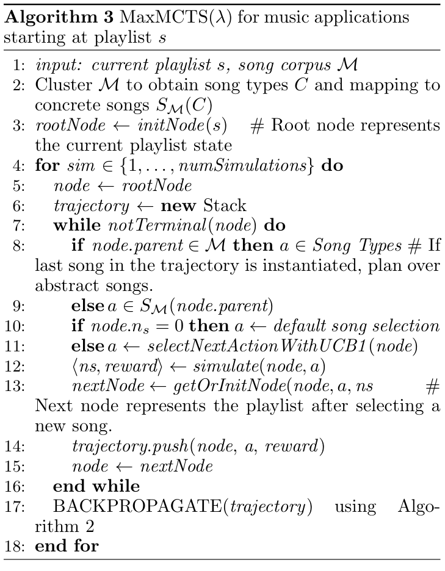
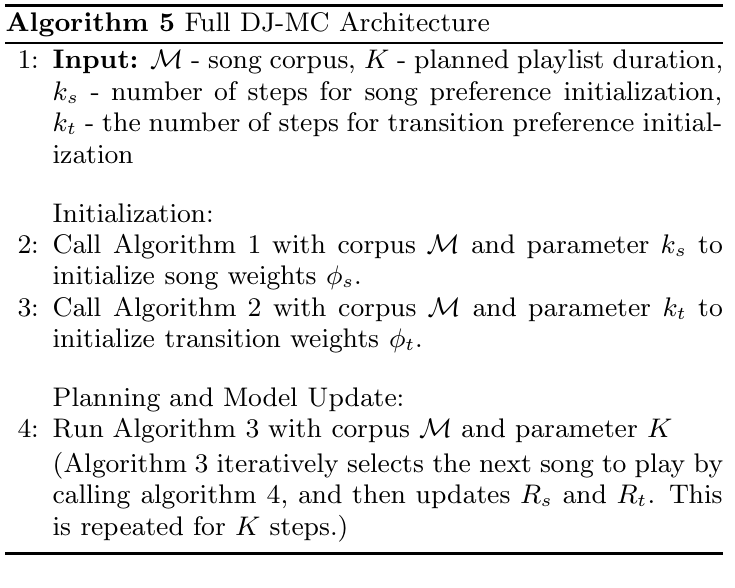
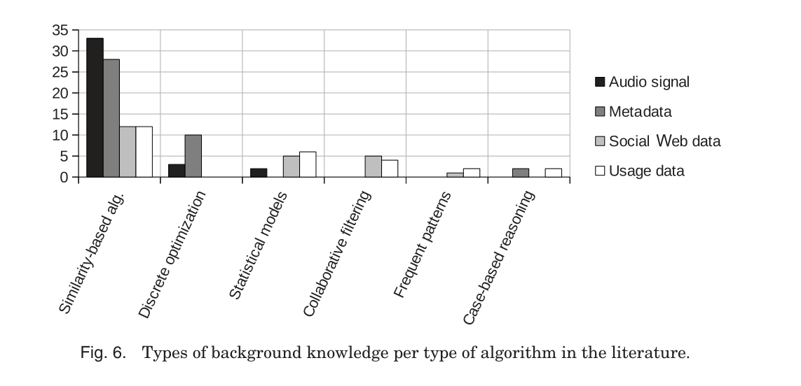
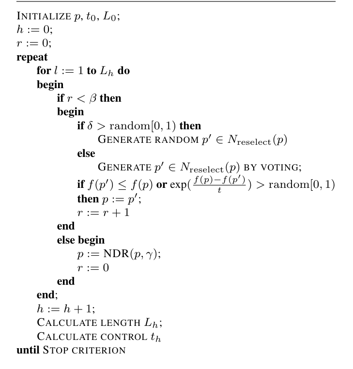

# 完整歌单搜索与序列规划

**任务现状综述**

任务说明：在限定歌曲数、候选范围和计算预算下，联合考虑位置匹配、相邻过渡与整体约束。规划与搜索文献结合改进模拟退火这一经典应用方法，覆盖项目中的搜索基线和整段序列优化问题。

---

## [P01] Stochastic Primal-Dual Decoding for Multiobjective Generative Recommender Systems（KDD 2026）

Spotify 研究团队提出，[发表于 KDD 2026](https://research.atspotify.com/publications/stochastic-primal-dual-decoding-for-multiobjective-generative-recommender-systems)。KDD 是数据挖掘与应用机器学习领域的重要国际会议，属于 CCF A 类。

**研究内容**

作者针对生成式歌单模型只追求推荐相关性、难以同时满足指定歌曲类别配额的问题，提出推理时的随机原始—对偶解码。歌单实验使用大型音乐平台两周内约 400 亿次交互、6,200 万用户和超过 4,200 万首歌曲，数据是用户—歌曲事件及辅助类别信息；另外检验首页列表和电商推荐。作者在 SASRec 等已训练模型的解码阶段加入动态对偶变量，根据已选歌曲和剩余配额调整下一首得分。创新是无需为每组目标重新训练主干，就能在生成整份列表时协调消费相关性与整体约束。

**方法与架构**

*原 Figure 1：多目标原始—对偶解码流程。*

已有生成模型给出下一项相关性，辅助目标与动态乘子共同调整选择得分；选择结果反馈到约束状态，用于后续位置。

**损失与优化目标**

本文新增的是解码优化层，主干仍按单目标相关性训练。正文的候选得分可以写为：

$$
\sigma(t_j)=p_\theta(t_j\mid x,t_{<k})+\lambda_k b(t_j).
$$

$b(t_j)$ 表示候选对辅助目标的贡献，$\lambda_k$ 随列表生成过程更新。整份列表受到辅助贡献总量约束；这不是固定权重的逐首评分，也没有额外的 VA 回归损失。

---

## [P02] Automatic Music Playlist Generation via Simulation-based Reinforcement Learning（KDD 2023）

Spotify 研究团队提出，[KDD 官方 Applied Data Science 论文目录收录](https://kdd.org/kdd2023/ads-track-papers/index.html)。KDD 属于 CCF A 类，本篇来自应用数据科学轨道。

**研究内容**

作者针对歌单效果依赖歌曲顺序及用户连续响应、离线推荐难以模拟真实交互的问题，提出基于模拟器的强化学习歌单生成。数据包含公开 Spotify 收听会话和线上平台交互，公开资源约有 1.6 亿会话，反馈包括跳过、完整收听等行为，歌曲带声学与上下文特征；这些反馈不是连续 VA 标签。作者先建立用户响应模拟器，再用接收状态与候选歌曲特征的 Action-Head DQN 学习决策，并探索模拟规划。创新是使动作空间可以面对大规模动态歌曲目录，同时在序列层面优化长期收听效果。

**方法与架构**

*原 Figure 1：模拟用户与强化学习推荐循环。*

推荐策略在模拟环境中选择歌曲，获得用户响应和奖励，再更新策略。

*原 Figure 2：Action-Head Q 网络。*

网络同时接收当前观测与候选歌曲特征，输出该状态—歌曲对的 Q 值，避免为所有歌曲设置固定输出头。

**损失与优化目标**

AH-DQN 使用均方时间差分误差，以即时反馈和折扣后的后续 Q 值构成目标，并周期更新目标网络。模拟规划比较未来多步的累计效用。论文优化的是跳过、收听等行为奖励，不能把其奖励直接理解为情绪端点达成度。

---

## [P03] Designing Better Playlists with Monte Carlo Tree Search（2017）

美国得克萨斯大学奥斯汀分校团队提出，发表于 AAAI 2017 的 IAAI 应用轨道。AAAI 主会属于 CCF A 类，本篇来自应用轨道，介绍时保留这一区别。

**研究内容**

作者要解决只按单曲喜好推荐、忽略歌曲顺序和相邻转移的问题。实验从 Million Song Dataset 抽取 5,000 首歌曲，使用 34 维声学描述并聚成 70 个歌曲类型，通过模拟用户评价 30 首歌曲组成的序列，报告 30 次重复实验；数据不是人工 VA 轨迹标注。作者借鉴强化学习和蒙特卡洛树搜索，同时学习歌曲偏好与转移偏好，再用 MaxMCTS 搜索未来序列。改进重点是通过歌曲类型降低规划分支数，让选歌考虑后续收益与新颖性。

**方法与架构**

**正文的原始方法材料是算法伪代码，不是单独的规划树架构图。** Figure 1–2 是结果图，因此补入原 Algorithm 1 和 Algorithm 3。

原 Algorithm 1，PDF 第 3 页：初始化歌曲/转移偏好，随后交替规划与更新。

聚类歌曲类型、选择/展开节点、模拟轨迹并回传价值。图片均从正文直接裁取，没有重绘。

**损失与优化目标**

核心是最大化序列累计 reward，没有监督神经训练 loss。正文式 (1) 为：

$$
R(\mathrm{Seq},a,\mathrm{Seq}')=\phi_s(u)\cdot\theta_s(a)+\phi_t(u)\cdot\theta_t(\mathrm{Seq},a).
$$

两项分别表示用户歌曲偏好和转移偏好。新颖性设置另采用单曲效用与历史歌曲差异的时间衰减项（正文式 (2)），其距离使用 34 维描述的欧氏距离；不应写成原文的 VA 轨迹奖励。

---

## [P04] DJ-MC: A Reinforcement-Learning Agent for Music Playlist Recommendation（AAMAS 2015）

美国得克萨斯大学奥斯汀分校团队提出，发表于 AAMAS 2015（CCF B 类会议，多智能体研究领域的重要国际会议）。

**研究内容**

作者希望推荐系统能在交互中学习用户对单曲和歌曲转移的不同偏好，而不是只计算歌曲相似度。音乐表示来自 Million Song Dataset 的 34 维音频分析，模拟实验每次抽取 1,000 首歌曲，并参考 Art of the Mix 的真实歌单构建用户模型；数据形式是歌曲特征、有序列表与反馈。作者借鉴强化学习代理和序列规划，分别估计歌曲收益与相邻转移收益，并在收集反馈后更新用户模型。改进重点是把在线偏好学习与未来歌单规划结合。

**方法与架构**

原 Algorithm 5，PDF 第 6 页。先初始化歌曲偏好和转移偏好，再交替进行树搜索规划与反馈更新；这是原始方法伪代码。

**损失与优化目标**

代理最大化歌曲收益和转移收益的累计回报，通过交互反馈更新个体偏好，再规划后续歌曲。目标是提高整段歌单的用户效用，正文没有连续 VA 轨迹监督损失。

---

## [P05] Automated Generation of Music Playlists: Survey and Experiments（ACM Computing Surveys 2014）

德国多特蒙德工业大学团队撰写，发表于 2014 年《ACM Computing Surveys》（CCF A 类期刊，计算机领域的高水平综述期刊）。

**研究内容**

作者针对自动歌单生成方法繁多、评价缺乏统一比较的问题，系统整理内容、协同、约束与序列等方法，并开展策略比较。实验使用 last.fm 和 Art of the Mix 各约 5 万个歌单，以及 8tracks 约 10 万个歌单；数据形式是用户组织的有序歌曲列表及相关信息，这些数量是实际实验子集。作者借鉴推荐系统的离线评价与歌单统计分析，比较生成和续接策略，讨论真实歌单中的顺序与共现规律。贡献是提供方法分类、比较实验和评价视角，而不是提出一个统一的新网络。

**方法与架构**

原 Figure 6，PDF 第 27 页（26:27）。这是综述的算法分类统计图，不是某个新模型架构；用于理解相似度、优化、统计模型、协同过滤等路线。

**损失与优化目标**

综述与比较实验没有一个统一训练损失。各类自动歌单方法分别采用相似度、约束满足、推荐评分或序列策略，正文通过共同评价设置比较它们。

---

## [P06] Fast Generation of Optimal Music Playlists using Local Search（2006）

荷兰飞利浦欧洲研究院团队提出，发表于 ISMIR 2006。ISMIR 是音乐信息检索领域的重要国际会议，不在当前 CCF 推荐目录中。

**研究内容**

作者要解决的是用户提出多种选歌与顺序要求后，如何在可接受时间内生成一份完整歌单。实验使用规模从 2,248 首到 71,194 首的音乐库；每首歌用歌曲、歌手、专辑、风格、时长、速度及音频特征等属性表示，用户要求则写成单个位置约束、两个位置之间的关系约束和整份歌单的全局约束。作者借鉴模拟退火，通过替换、插入、删除和交换歌曲搜索歌单，并加入歌曲候选范围缩减、约束投票和两级邻域，改进重点是兼顾约束满足、生成速度和用户评价，而非只推荐相似歌曲。

**方法与架构**

*原 Figure 1：用于完整歌单生成的改进模拟退火算法。*

先初始化歌单与退火控制参数，再交替进行选歌调整和顺序交换。每次修改都重新评估歌单的约束违反程度；有时允许接受稍差的歌单，以跳出局部最优，随后逐步降低接受差解的概率。

**损失与优化目标**

原文是搜索方法，没有神经网络训练损失。它把每条约束的违反程度归一化到 $[0,1]$，再取加权平均作为歌单代价。按原文文字定义整理为：

$$
f(p)=\frac{\sum_c w_c\,\operatorname{penalty}_c(p)}{\sum_c w_c},\qquad
\min_p f(p).
$$

原文的退火接受规则为：

$$
\Pr(p'\mid p)=
\begin{cases}
1,&f(p')\leq f(p),\\
\exp\big((f(p)-f(p'))/t\big),&f(p')>f(p).
\end{cases}
$$

$p$ 为当前歌单，$p'$ 为修改后的歌单，$t$ 为退火控制参数。代价为零表示全部约束满足；约束不能全部满足时，算法寻找违反程度尽量小的完整歌单。
