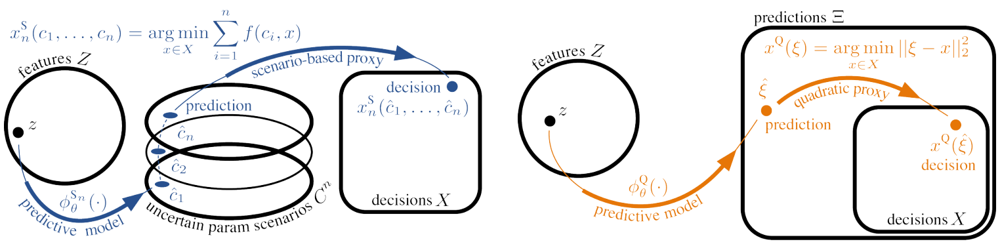
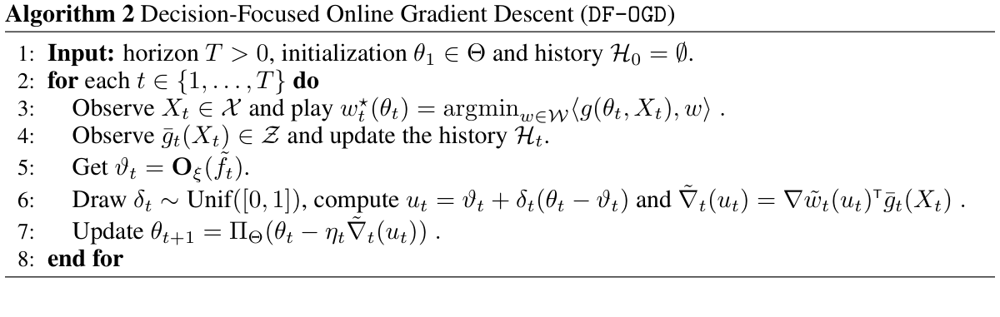
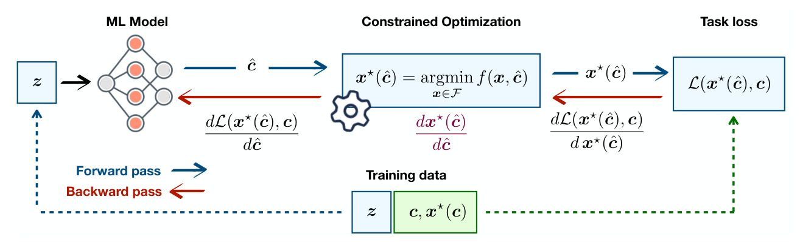
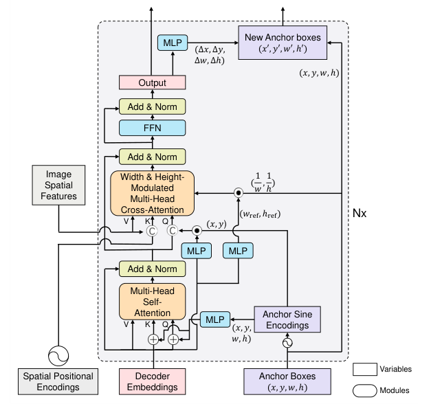
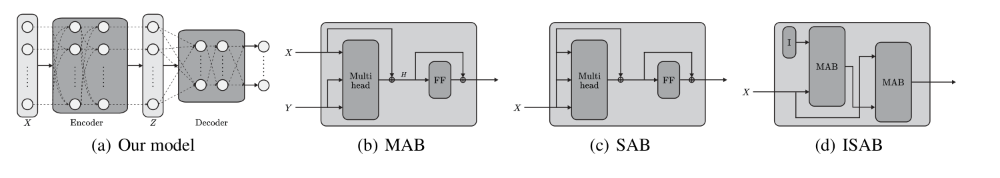
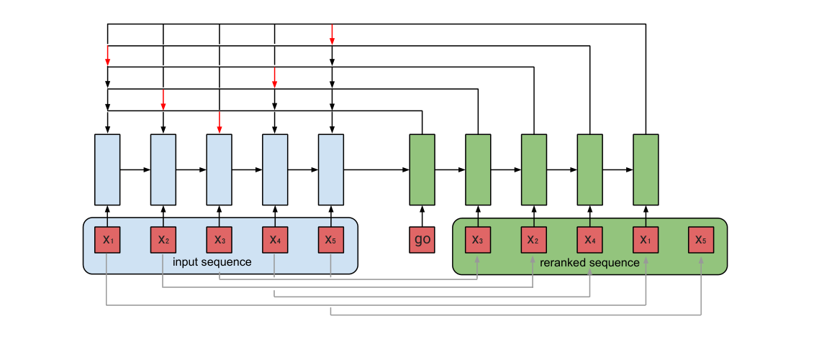

# 候选分配、位置查询与决策收益学习

**任务现状综述**

任务说明：用位置条件查询寻找各阶段候选，把已选歌曲作为集合建模，并依据加入候选后完整歌单的代价变化判断其单点价值和成对作用。下面分别列出位置查询、集合交互、决策学习和逐步列表选择的方法基础；这些论文主要来自通用机器学习与推荐排序，原实验任务在每篇研究内容中说明。

---

## [P01] Sufficient Decision Proxies for Decision-Focused Learning（IJCAI 2026）

荷兰代尔夫特理工大学团队与独立研究者合作，[发表于 IJCAI 2026 主会](https://www.ijcai.org/proceedings/2026/260)。IJCAI 是人工智能领域的重要国际会议，属于 CCF A 类。

**研究内容**

作者针对决策导向学习中一个容易忽略的问题：即使预测网络足够强，过于简单的预测—决策接口也可能无法产生真正最优的决策。实验包括真实金融数据的投资组合和合成的集合多覆盖、两阶段背包问题，样本形式是上下文、随机成本或权重，以及满足约束的决策。作者提出多情景代理、二次投影代理等方案，扩大可产生的决策范围。创新在于分析决策代理是否“足够表达”，这为候选集合及预算分配提供方法依据；实验不涉及音乐序列。

**方法与架构**

*原 Figures 2–3：多情景与二次投影决策代理。*

两幅相邻原图并列保留：左图由多个预测情景形成决策，右图先预测无约束决策表示，再投影到可行集合。

**损失与优化目标**

优化目标是预测经代理产生的决策在真实不确定条件下的期望成本，可整理为：

$$
\min_\theta\;\mathbb E_{z,c}\big[f(c,x_{\mathrm{proxy}}(\phi_\theta(z)))\big].
$$

二次代理内部另求 $\arg\min_{x\in\mathcal X}\|\hat\xi-x\|_2^2$，用于保证输出可行。这个投影目标属于决策求解器，不能混同于外层预测网络的全部训练损失。

---

## [P02] Online Decision-Focused Learning（ICLR 2026）

法国巴黎综合理工学院、CNRS、INRIA、巴黎高师、加州大学伯克利分校等团队合作，作者包括 Eric Moulines 和 Michael I. Jordan，[发表于 ICLR 2026](https://proceedings.iclr.cc/paper_files/paper/2026/hash/4e14a2a225d5d186b7eb1ecc7605bc2d-Abstract-Conference.html)。按 CCF 2026 目录，ICLR 为 A 类。

**研究内容**

作者研究预测模型在环境持续变化时，如何按最终决策的代价而非只按预测误差进行在线更新。实验使用带上下文的合成组合选择问题，数据是上下文特征、随后观测的候选代价及可行决策集合，不是音乐数据集。方法结合在线学习、决策导向目标和平滑或扰动优化，给出静态与动态遗憾分析，并用近似优化器更新预测模型。创新在于把“预测是否改善最终选择”放进在线学习过程，可用于理解候选预算分配这类有约束决策，但理论结论依赖文中的假设。

**方法与架构**

*原 Algorithm 2：DF-OGD 在线决策学习步骤。*

方法按获得上下文、求解决策、观察代价和梯度更新逐步执行；正文以在线算法为主，没有神经网络总架构图。

**损失与优化目标**

训练关心真实代价作用在预测所产生决策上的结果：

$$
w_t^*(\theta)=\arg\min_{w\in\mathcal W}\langle g_\theta(X_t),w\rangle,\qquad
f_t(\theta)=\langle c_t,w_t^*(\theta)\rangle.
$$

$g_\theta(X_t)$ 是预测代价，$c_t$ 是真实代价。论文进一步通过正则化和平滑处理优化器的可微性；目标的好坏要按决策成本和遗憾衡量。

---

## [P03] Decision-Focused Learning: Foundations, State of the Art, Benchmark and Future Opportunities（2024）

比利时鲁汶大学、布鲁塞尔自由大学和美国弗吉尼亚大学等团队合作，发表于 Journal of Artificial Intelligence Research（JAIR）2024，属于 CCF B 类人工智能期刊。本篇是带统一基准实验的研究综述。

**研究内容**

作者关注的是“预测数值更准，最终决策是否一定更好”：预测模型的误差即使很小，也可能改变搜索或分配结果。论文统一比较 11 种决策学习方法与 7 个基准问题，其中包括人工生成的图路径代价数据、Warcraft 地形图像与路径标签，以及 SEMO 电价时间序列和作业调度约束；数据形式既有特征—代价向量，也有图像—路径和时间序列—调度问题，并非音乐数据。作者系统整理可微优化、随机扰动和代理损失等路线，把训练目标从单纯预测误差转向最终决策质量，并通过公共基准比较这些方法的效果与计算开销。

**方法与架构**

*原 Figure 3：由最终任务损失训练预测模型的决策学习流程。*

模型先从输入特征预测优化问题的参数，约束优化器再输出决策，最后用真实参数评估该决策。训练信号从任务损失穿过优化器返回预测模型；不同方法处理离散优化不可直接求导的问题。

**损失与优化目标**

原文以 regret，即决策后悔值，作为典型任务损失：

$$
\hat c=m_\omega(z),\qquad
x^\star(\hat c)=\arg\min_{x\in\mathcal F}f(x,\hat c),
$$

$$
\mathcal L_{\rm regret}=f(x^\star(\hat c),c)-f(x^\star(c),c).
$$

$z$ 为输入特征，$c$ 为真实代价参数，$\hat c$ 为预测参数，$\mathcal F$ 为可行解集合。损失衡量“使用预测值作出的决策”比“知道真实值时的最优决策”差多少，让训练优先减少会损害最终决策的预测误差。

---

## [P04] DAB-DETR: Dynamic Anchor Boxes are Better Queries for DETR（2022）

清华大学、香港科技大学、粤港澳大湾区数字经济研究院（IDEA）和鹏城实验室等团队合作，发表于 ICLR 2022。按 2026 年 CCF 推荐目录，ICLR 属于 A 类国际会议。

**研究内容**

作者研究的是目标检测中“查询应该去图像的什么位置找目标”的问题。实验使用 MS-COCO 2017，数据形式是图像及其目标类别、边界框标注，并非音乐歌单数据。原有 DETR 用抽象的可学习向量作为查询，位置含义不够明确、收敛较慢；作者把查询的位置部分改成可以逐层更新的四维锚框坐标，同时保留内容表示，并用锚框的宽高调节注意力范围，创新在于让位置先验与内容匹配协同参与查询和特征聚合。

**方法与架构**

*原 Figure 5：DAB-DETR 解码器的完整方法架构。*

内容查询和锚框位置编码进入自注意力，随后与图像特征进行交叉注意力。每层预测锚框的坐标修正，并把更新后的锚框交给下一层；图中的宽高控制空间关注范围。

**损失与优化目标**

正文沿用 DETR 的二分图匹配监督：先将预测目标与真实目标进行一对一匹配，再计算类别和边界框损失。按这种监督组成概括为：

$$
\mathcal L=\lambda_{\rm cls}\mathcal L_{\rm cls}
+\lambda_{\rm box}\mathcal L_{\rm box}
+\lambda_{\rm giou}\mathcal L_{\rm GIoU}.
$$

类别项负责识别目标，边界框项负责坐标精度，GIoU 项约束预测框与真实框的几何重合程度。论文的主要改动在查询表示和逐层位置更新，最终仍通过匹配后的检测结果进行监督。

---

## [P05] Set Transformer: A Framework for Attention-based Permutation-Invariant Neural Networks（2019）

英国牛津大学、韩国浦项科技大学（POSTECH）以及 AITRICS、Kakao 团队合作，发表于 ICML 2019，属于 CCF A 类国际会议。

**研究内容**

作者要解决的是如何建模一个无固定顺序、大小可变的集合，并保留元素之间的相互作用。实验包括实数集合最大值预测、Omniglot 手写字符图像集合的不同字符计数，以及人工二维点集和 CIFAR-100 图像特征集合的聚类；每条样本是一组元素，而不是一条固定长度音乐序列。作者借鉴 Transformer 注意力和稀疏高斯过程中的诱导点，用自注意力学习集合内部关系，再用可学习的种子查询聚合集合；创新在于避免简单求平均丢失关系信息，并在诱导点数量固定时降低集合建模的计算开销。

**方法与架构**

*原 Figure 1：Set Transformer 总体结构及 MAB、SAB、ISAB 模块。*

编码器用 SAB 或 ISAB 建模元素之间的关系；解码器通过多头注意力池化 PMA，把可变大小的集合汇总为一个或多个输出。集合整体表示不随输入元素排列改变，元素级表示则跟随元素排列变化。

**损失与优化目标**

Set Transformer 是集合建模结构，没有一项适用于所有任务的专用损失。原文最大值预测任务使用：

$$
\mathcal L_{\rm max}=\left|\hat y-\max_{i\in X}x_i\right|.
$$

原文聚类任务则让模型输出混合高斯参数，并最大化数据似然；写成最小化形式为：

$$
\mathcal L_{\rm cluster}=-\sum_{i=1}^{n}\log\left[\sum_{j=1}^{k}\pi_j\,\mathcal N(x_i;\mu_j,\operatorname{diag}(\sigma_j^2))\right].
$$

这两个目标分别监督集合的整体统计量与聚类结构，说明同一套集合编码器可以配合不同任务的监督目标。

---

## [P06] Seq2Slate: Re-ranking and Slate Optimization with RNNs（2019）

Google 研究团队提出，核验到的版本为 2019 年 arXiv 预印本。Google 官方文献页面也将其列为 arXiv 论文，不标为已发表于某个 CCF 会议。

**研究内容**

作者研究的是如何让整份推荐列表里的项目彼此配合，避免每个项目独立打分后直接排序。实验使用 Yahoo Learning to Rank 和 Microsoft Web30k，数据形式是查询—候选文档特征、相关性标签及据此模拟的点击反馈，并另外进行真实推荐系统验证；这些不是音乐歌单数据。作者借鉴序列到序列模型和指针网络，每一步根据已经选入列表的项目重新判断剩余项目，再从原候选集合中选择下一项，创新在于把项目之间的相互影响直接纳入列表生成过程，并探索弱点击监督和策略梯度两种训练方式。

**方法与架构**

*原 Figure 1：Seq2Slate 的指针网络重排序架构。*

RNN 编码输入候选列表；解码器结合已有输出与注意力，在尚未选择的候选中指向下一项。输出是输入项目的重新排列或截取，已选择项目会被屏蔽。

**损失与优化目标**

按原文式（5）和式（6）整理，其逐步交叉熵监督可写为：

$$
\mathcal L_\pi=\sum_{j}w_j\left[-\sum_{i\notin\pi_{<j}}\hat y_i^{(j)}\log p_\theta(i\mid\pi_{<j},x)\right].
$$

每一步只在尚未选中的项目上计算损失，$\hat y_i^{(j)}$ 是当前剩余标签归一化后的目标，$w_j$ 可提高前排位置的权重。原文还使用策略梯度直接优化列表的期望奖励：

$$
\max_\theta\mathbb E_{\pi\sim p_\theta(\cdot\mid x)}[R(\pi,y)].
$$

实验中的一种奖励是 NDCG@10，并采用奖励基线降低梯度方差。它关注整份列表的质量，而非仅压低每个候选的独立预测误差。
