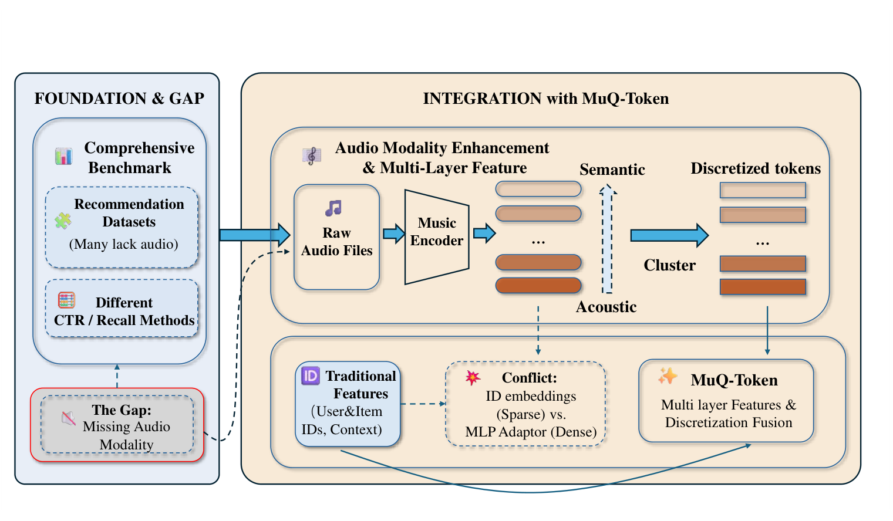
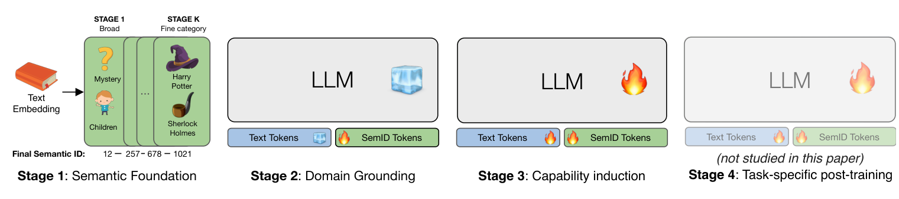
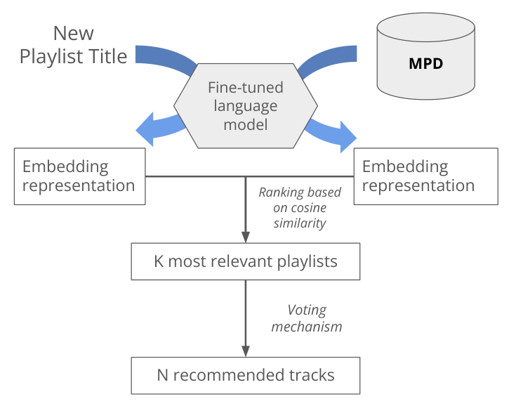
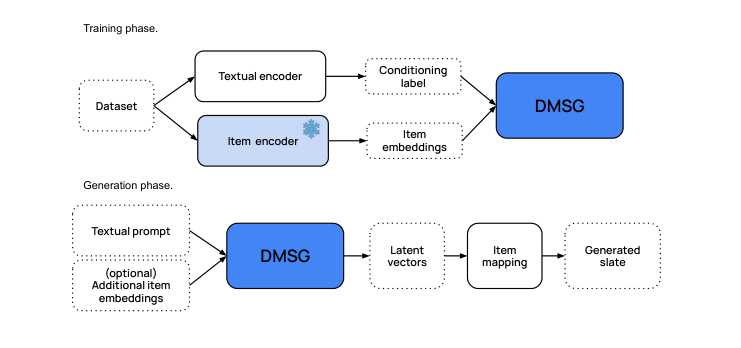
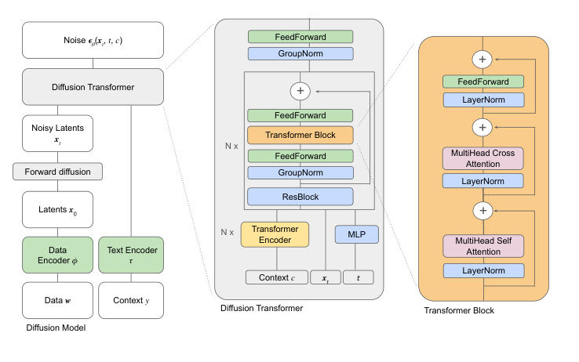
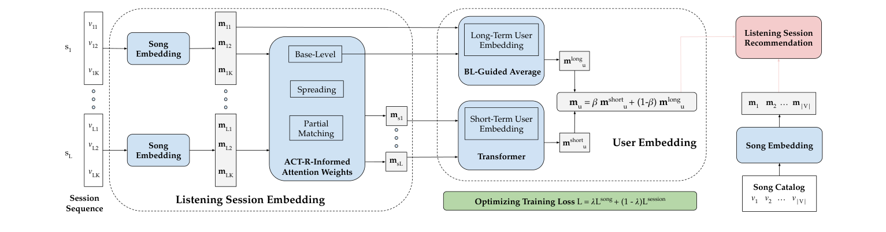
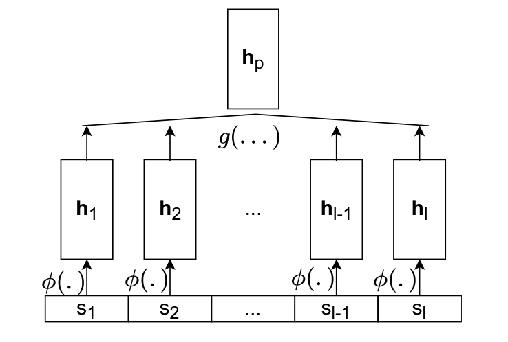

# 音乐序列推荐与自动歌单续接（应用研究）

**任务现状综述**

任务说明：文字需求如何生成完整歌单、已有歌单如何续接，以及历史收听序列怎样形成用户偏好。文献来自 Spotify、Deezer 等真实音乐平台，结合公开歌单或收听日志及实际系统验证。这类任务通常以推荐相关性、偏好和使用效果为目标，情绪端点与整段过渡要求由轨迹和规划任务进一步覆盖。

---

## [P01] Revisiting Content-Based Music Recommendation: Efficient Feature Aggregation from Large-Scale Music Models（2026）

南京大学 LAMDA、人工智能学院和计算机软件新技术全国重点实验室团队提出，作者包括詹德川与周大伟，公开为 [2026 年 arXiv 预印本](https://arxiv.org/abs/2604.20847)。尚无正式会议或期刊等级。

**研究内容**

作者针对音乐推荐偏重用户与歌曲 ID、原始音频缺失，以及大模型音频表示直接接入推荐网络时与稀疏 ID 表示冲突的问题，构建 TASTE 评测框架。数据基于 Music4all、LFM-1b 和 LFM-2b，把用户—歌曲—时间交互与可获取的音频及文本匹配；对音频可匹配的子集分别开展候选召回和 CTR 预测。作者从 MuQ 提取多层表示，对每一层聚类，把歌曲变成一组离散层级 token，再与用户、歌曲和上下文特征联合建模。创新是保留层间互补信息，并改善音频表示接入推荐模型的方式。

**方法与架构**

*原 Figure 1：TASTE 与 MuQ-token 推荐框架。*

上方为音频补全、多层特征提取和离散化，下方把多层 token 与传统推荐特征结合。该图展示召回与排序共用的表示接入流程。

**损失与优化目标**

论文将重复交互次数达到阈值的用户—歌曲对转为 CTR 正样本，并以 LogLoss 和 AUC 评价；召回比较 BPR、VBPR 等基线及其训练目标。MuQ-token 的贡献是特征离散化与融合，没有提出一个替代全部召回、CTR 模型的新统一损失，也没有直接优化多位置情绪过渡。

---

## [P02] A Unified Model for Personalization: Language-Steerable Generative Recommendation, Search, and User Understanding（KDD 2026）

Spotify 研究团队提出，作者包括 Mounia Lalmas、Paul Bennett 和 Praveen Chandar 等，[发表于 KDD 2026](https://research.atspotify.com/publications/unified-model-personalization-language-steerable-generative-recommendation-search-user-understanding)，属于 CCF A 类。本文图件来自同一工作的公开预印本正文，其标题为 A Unified Language Model for Large Scale Search, Recommendation, and Reasoning。

**研究内容**

作者针对搜索、推荐和用户理解分别建模、自然语言控制难以稳定落到实际媒体目录的问题，提出 NEO。训练与测试来自 Spotify 真实媒体目录及用户行为，覆盖超过千万级媒体实体和约 1,500 万用户，输入包括历史消费、文字请求、实体元数据和语义 ID；目录涉及播客、有声书、艺人等，并非全部为单首歌曲。作者以语言模型统一文字和类型化语义 ID，分阶段学习目录知识、模态对齐与指令响应。创新是让推荐和搜索可以受语言引导，同时保持实体可定位，可支持音乐推荐应用的目录约束与交互设计。

**方法与架构**

*原 Figure 2：NEO 分阶段训练方案。*

前三阶段分别为语义 ID 预训练、文字—ID 对齐和指令微调。原图第四阶段标为未来或未研究内容，不能将其写成已经完成的强化学习实验。

**损失与优化目标**

训练沿用文本与语义 ID 序列的自回归下一 token 预测，各阶段的输入和目标任务不同。目录约束通过实体表示和解码机制实现；原文没有 VA 轨迹损失，也没有证明歌单情绪路径的达成。

---

## [P03] A Language Model-Based Playlist Generation Recommender System（RecSys 2025）

法国 EURECOM 团队提出，作者包括 Raphaël Troncy 和 Pasquale Lisena 等，[发表于 RecSys 2025](https://www.eurecom.fr/publication/8304/download/data-publi-8304.pdf)。RecSys 是推荐系统领域的重要国际会议，属于 CCF B 类。

**研究内容**

作者研究只有一个新歌单标题、没有种子歌曲时，怎样生成相关歌曲推荐。实验使用 Spotify Million Playlist Dataset，包含 100 万份用户歌单，数据是歌单标题、歌曲列表、歌曲及艺人信息，并转为可聚类的文字表示。作者借鉴 SBERT 语义检索，先根据歌单内容聚类，再用簇标签微调语言模型；新标题编码后检索相近的已知歌单，以歌曲投票选出推荐列表。创新是将真实歌单组织结构用于标题驱动的冷启动推荐；虽然使用歌单数据，最终方法没有显式学习每个位置的 VA 或情绪过渡。

**方法与架构**

*原 Figure 1：歌单表示、聚类与语言模型微调。*

正文 PDF 第 3 页。MPD 形成歌单表示，聚类结果作为微调监督，得到适合歌单主题的文本编码器。

*原 Figure 2：新标题到歌单歌曲的推荐流程。*

新标题与已有歌单编码后进行余弦相似度排序，再从最相关的 K 份歌单进行歌曲投票，选出 N 首歌曲。

**损失与优化目标**

原文分别测试以歌单簇为类别的交叉熵微调和三元组微调两种方案，交叉熵方案在主要实验中表现较好。二者是比较方案，不是被同时相加的联合损失；后续相似歌单检索和歌曲投票属于推荐阶段。

---

## [P04] Prompt-to-Slate: Diffusion Models for Prompt-Conditioned Slate Generation（2025）

Spotify 研究团队提出，发表于 RecSys 2025 主会。RecSys 是推荐系统领域的重要国际会议，属于 CCF B 类。

**研究内容**

作者要解决的是用户给出自然语言需求后，如何直接生成一整份相关且多样的歌单，而不是逐首独立检索。实验使用 Spotify Million Playlist Dataset（MPD）中抽取的 10 万份歌单、含 3 万份编辑歌单的 Curated 数据，以及电商组合数据；音乐样本由歌单文本信息、有序歌曲列表和歌曲表示组成，训练时把序列补齐或截断到最多 32 个位置。作者借鉴条件扩散模型，在歌曲表示空间联合学习整份歌单的结构，以文字条件引导去噪，再映射回现有曲库歌曲；创新在于建模整份列表的联合分布，并在生产歌单系统中开展在线验证。

**方法与架构**

*原 Figure 1：DMSG 的训练与歌单生成流程。*

训练时将歌单歌曲映射为连续向量，以文本表示作为条件学习去噪。生成时从随机潜变量出发，得到整份列表的歌曲向量，再映射到曲库中的歌曲；输出是歌曲列表。

*原 Figure 2：条件扩散 Transformer 的内部结构。*

自注意力建模列表内部关系，交叉注意力注入文字条件。图中给出通用的噪声预测流程；正文实际训练采用 v-prediction 参数化。

**损失与优化目标**

原文式（2）使用速度参数化的扩散预测损失，整理为：

$$
\mathcal L_{\rm DMSG}=\mathbb E_{t,x_0,v}\left[\left\|v-v_\theta\big(\sqrt{\bar\alpha_t}x_0+\sqrt{1-\bar\alpha_t}\epsilon,t,c\big)\right\|_2^2\right].
$$

$x_0$ 是原歌单的连续表示，$\epsilon$ 是加噪用的高斯噪声，$c$ 是文本条件，$v$ 是扩散过程的训练目标；这里的“速度”是扩散参数化概念。该损失让模型学会恢复整份列表的潜在结构；推理采用 DDIM 减少采样步数，最后通过曲库映射得到歌曲。

---

## [P05] Transformers Meet ACT-R: Repeat-Aware and Sequential Listening Session Recommendation（2024）

Deezer 研究团队提出，发表于 RecSys 2024 主会，属于 CCF B 类推荐系统国际会议。

**研究内容**

作者要解决的是音乐推荐中常见的重复收听与新歌探索如何同时建模的问题。实验使用 Last.fm 的 LFM-1b 与 Deezer 收听日志，数据形式是匿名用户、歌曲 ID 和时间戳组成的事件序列，再切成每次最多 10 首歌的收听会话；处理后分别约有 46.5 万和 210 万个会话，任务是根据过去多个会话预测下个会话会听的歌曲集合。作者借鉴认知架构 ACT-R 中的记忆激活机制，将收听次数、时间远近和歌曲关联融入注意力，再结合 Transformer 建模会话序列；创新在于显式考虑音乐反复聆听的习惯，同时预测熟悉歌曲与新歌曲。

**方法与架构**

*原 Figure 2：PISA 的会话建模和音乐推荐架构。*

先利用 ACT-R 启发的权重聚合每次会话的歌曲表示，再分别形成长期偏好和 Transformer 学到的短期偏好，两者融合成用户表示，最后对曲库歌曲评分。会话之间按时间排列，预测目标是下一次会话的歌曲集合。

**损失与优化目标**

原文将歌曲级 BPR 损失与会话级对齐损失相加：

$$
\mathcal L=\lambda\mathcal L_{\rm song}+(1-\lambda)\mathcal L_{\rm session}.
$$

按原文式（13）和式（14），省略对用户序列的外层求和后表示为：

$$
\mathcal L_{\rm song}=\sum_l\sum_{v\in s_{l+1},\,v'\in o_{l+1}}\log\left[1+\exp\big(-(m_{u,l}^{\top}m_v-m_{u,l}^{\top}m_{v'})\big)\right],
$$

$$
\mathcal L_{\rm session}=\sum_l\big(1-m_{u,l}^{\top}m_{s_{l+1}}\big).
$$

$m_{u,l}$ 是观察前 $l$ 次会话后的用户表示，$s_{l+1}$ 为真实下一次会话，$o_{l+1}$ 为采样的负歌曲集合。歌曲级损失让真实歌曲排在负歌曲前面，会话级损失让用户表示靠近下一次会话的整体表示，记忆模块将重复收听的信息引入上述推荐训练。

---

## [P06] A Scalable Framework for Automatic Playlist Continuation on Music Streaming Services（2023）

Deezer 研究团队与法国巴黎多芬大学（巴黎文理研究大学 PSL 成员）合作，发表于 SIGIR 2023，属于 CCF A 类信息检索国际会议。

**研究内容**

作者研究的是在百万级曲库中，怎样根据用户已经建立的歌单快速推荐后续歌曲，并兼顾推荐效果与延迟。离线实验使用完整 MPD，包含 100 万份歌单和超过 200 万首歌曲；数据形式是有序歌曲 ID 列表及歌手、专辑、时长、流行度等元数据，实验保留 1—10 首开头歌曲并预测被遮住的后续歌曲，另在 Deezer 生产环境进行在线 A/B 测试。作者提出 Represent-Then-Aggregate（RTA），先离线计算每首歌曲的表示，再在线聚合已有歌单得到查询向量，通过快速内积评分找候选，创新在于让歌曲表示学习和歌单序列建模兼容，同时控制大规模在线推理成本。

**方法与架构**

*原 Figure 3：RTA 的歌曲表示与歌单聚合框架。*

每首歌先经过表示函数 $\phi$，已有歌单的歌曲向量再由聚合函数 $g$ 形成歌单向量。原文比较平均池化、CNN、GRU 和 Transformer 等聚合方式；最终与候选歌曲向量做内积，返回续接推荐列表。

**损失与优化目标**

原文式（8）和式（9）对歌单的每个前缀分别计算正样本与负样本损失，合并为：

$$
\mathcal L(p)=-\sum_{i=1}^{l-1}\log\sigma(f(p_{:i},s_{i+1}))
-\sum_{i=1}^{l-1}\sum_{s^-\in S^-(p)}\log\big[1-\sigma(f(p_{:i},s^-))\big].
$$

$p_{:i}$ 是歌单前 $i$ 首歌曲，$s_{i+1}$ 是真实下一首，$S^-(p)$ 为从该歌单以外采样的歌曲，$\sigma$ 为 sigmoid。损失提高真实续接歌曲的评分、降低负歌曲评分；论文另用训练时间与推理延迟评价可扩展性，不把这些指标写成新的训练损失。
