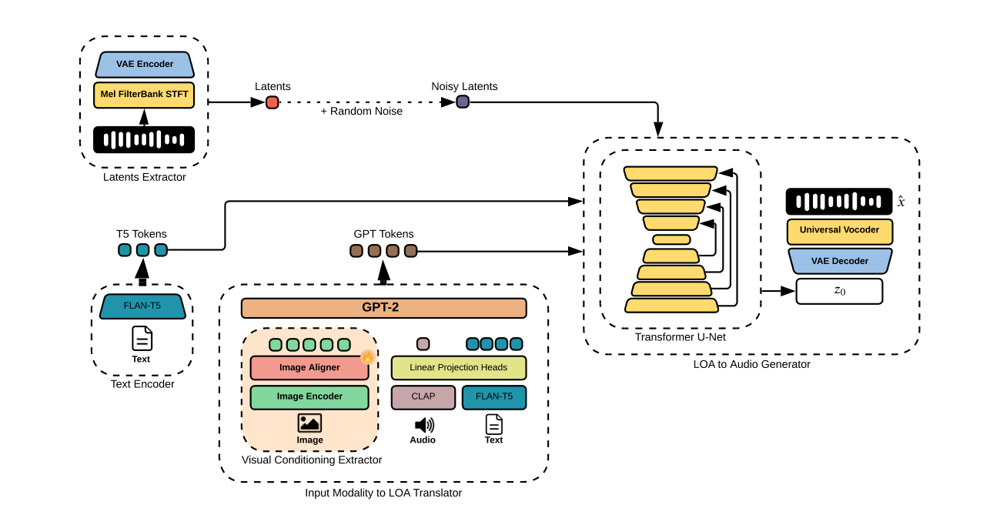
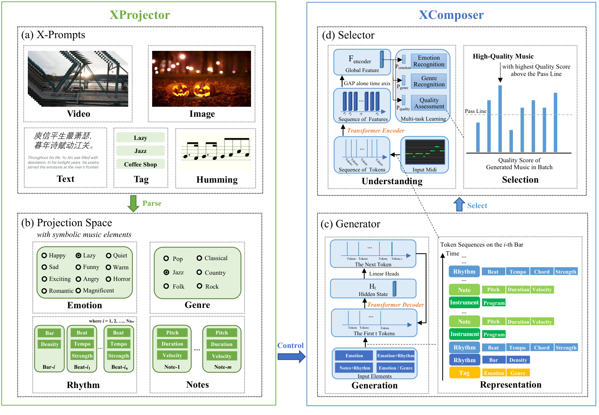
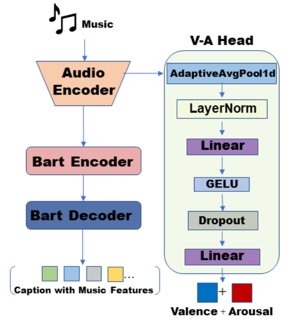
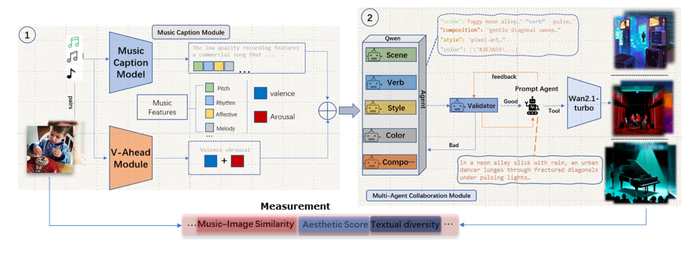
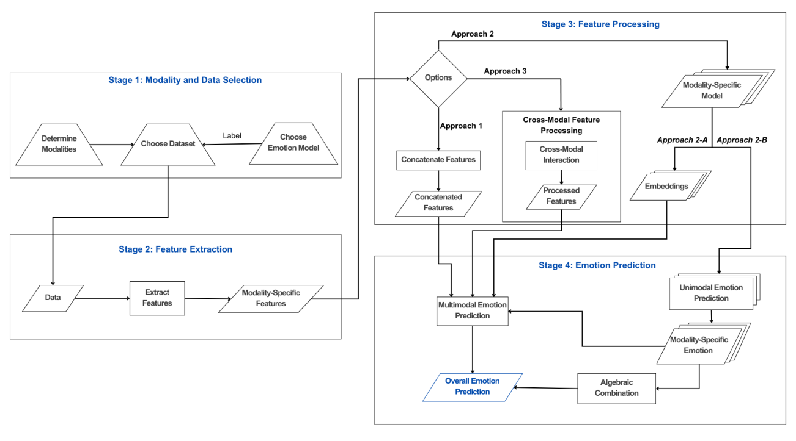
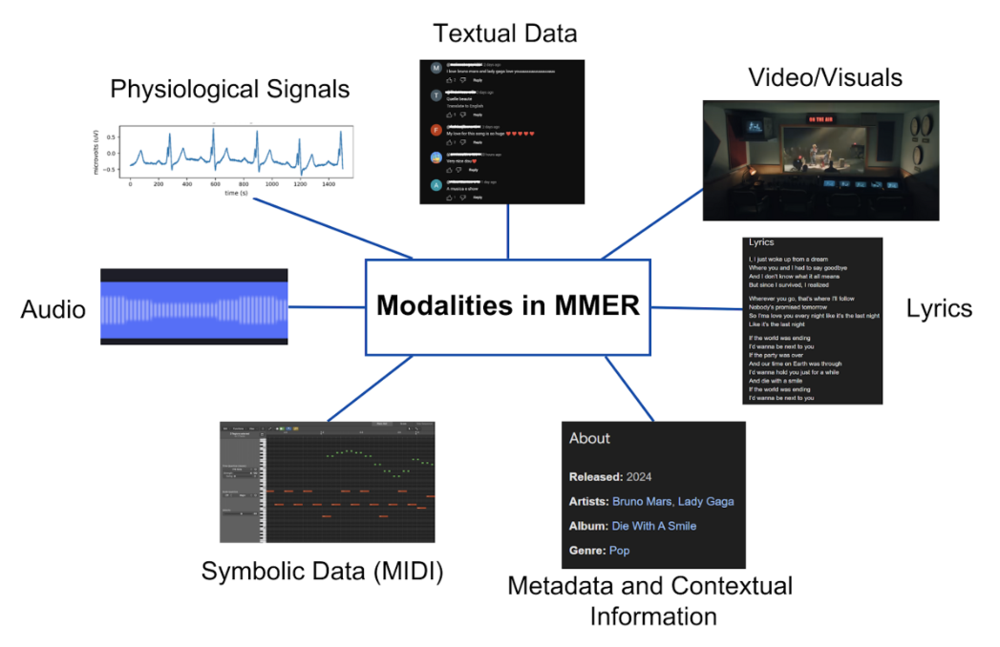
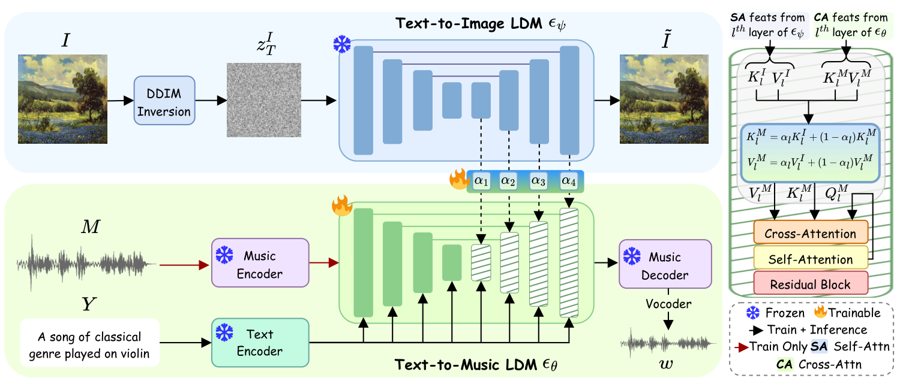
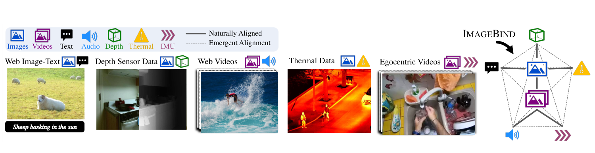

# 图像—音乐—文本与生成扩展

**任务现状综述**

任务说明：关注图像条件、跨模态情绪和音乐生成，作为可能的输入模态与生成方向扩展。当前第二个工作的主流程以文字条件和已有曲库中的歌曲序列为中心，这些文献作为扩展方向单独组织。

---

## [P01] Art2Mus: Artwork-to-Music Generation via Visual Conditioning and Large-Scale Cross-Modal Alignment（2026）

意大利巴里大学、加泰罗尼亚电信技术中心、法国皮卡第儒勒·凡尔纳大学等团队合作，公开为 [2026 年 arXiv 预印本](https://arxiv.org/abs/2602.17599)。尚无正式会议或期刊等级。

**研究内容**

作者针对艺术图像到音乐的配对数据不足、仅把图像转成文字容易损失视觉风格的问题，提出 Art2Mus。ArtSound 包含 105,884 个艺术作品—音乐对，结合 ArtGraph 的作品与 Free Music Archive 音乐，并用跨模态匹配和描述扩展构建配对，不能把全部配对理解为人工确认的情绪一致样本。方法借用 AudioLDM 2 的生成先验，用图像编码与对齐模块直接映射到音频条件空间，驱动冻结扩散主干生成音乐；系统仍保留固定的通用文本提示。创新在于视觉条件到音频表示的直接适配，属于多模态输入和音乐生成扩展。

**方法与架构**

*原 Figure 3：Art2Mus 总体架构。*

图像条件经编码器、对齐器与 GPT-2 LoA 翻译模块进入音频扩散生成器；原图的潜变量、随机噪声、文本支路和音频输出完整保留。

**损失与优化目标**

生成训练沿用扩散噪声回归，并使用 Min-SNR 权重：

$$
\mathcal L_t=\frac{\min(\mathrm{SNR}_t,\gamma)}{\mathrm{SNR}_t}\|\epsilon-\epsilon_\theta(z_t,t,c)\|_2^2,\qquad \gamma=5.
$$

这是按扩散时间步信噪比重加权的噪声预测目标；图像—音乐配对负责条件对齐。它没有优化现有曲库中的候选歌单，也没有连续 VA 端点监督。

---

## [P02] XMusic: Towards a Generalized and Controllable Symbolic Music Generation Framework（IEEE TMM 2025）

腾讯音乐生成研究团队提出，[发表于 IEEE Transactions on Multimedia 2025](https://xmusic-project.github.io/)。TMM 是多媒体领域的重要 IEEE Transactions 期刊，属于 CCF B 类。

**研究内容**

作者针对音乐生成条件各不相同、情绪控制和生成质量难以兼顾的问题，提出 XMusic。自建 XMIDI 含 108,023 个 MIDI 文件，音乐以音高、时值、力度、乐器和节拍等符号事件表示，标注 11 类情绪与 6 类流派；情绪是类别标签，不是连续 VA 区间。XProjector 将图像、视频、文字、标签与哼唱映射为情绪、流派、节奏和音符条件，XComposer 再生成 MIDI，并以质量、情绪和流派多任务选择器筛选。创新是统一多种输入条件、逐小节控制情绪并增加生成结果筛选，输出为新创作的符号音乐。

**方法与架构**

*原 Figure 2：XProjector 与 XComposer 完整框架。*

左侧将多模态输入投影为音乐元素，右侧同时展示 Transformer 生成器与质量选择器。模块标题、控制箭头和全部输出分支完整保留。

**损失与优化目标**

生成器以交叉熵预测下一事件，先预测事件类型，再预测音高、时值等属性。选择器以整段 MIDI 表示分别预测质量、情绪和流派类别；正文没有给出统一的多任务损失权重公式。推理阶段依据质量概率和阈值选择结果，因此质量筛选不是连续情绪轨迹校准。

---

## [P03] Multi Agents Semantic Emotion Aligned Music to Image Generation with Music Derived Captions（2025）

北京科技大学团队提出，当前核验到的是 2025 年 arXiv 预印本，尚未核验正式期刊或会议信息，因此不填写发表等级。

**研究内容**

作者希望从音乐生成既符合内容语义、又符合情绪的图像，降低单一描述丢失音乐风格与情感信息的问题。音乐描述模块使用 JamendoMaxCaps；VA 预测使用 DEAM，将音乐切成约 1.62 万个五秒片段，并对逐帧标注取均值；视觉情绪预测使用带 26 类情绪及连续 VAD 标注的 EMOTIC。整体数据形式包括音乐音频、描述文字和情绪图像，各部分并非天然配对三元组。作者借鉴音乐字幕、语言模型代理协作和条件图像生成，分别抽取语义、风格与情绪，再由提示与验证代理组织生成条件，重点是维持语义与情绪一致性。

**方法与架构**

原文方法是 multi-agent semantic–emotion aligned music-to-image pipeline，模块包括：

1. music captioning agent：从音乐生成结构化描述；
2. style extraction agent：抽取 genre、tempo 等风格属性；
3. affect extraction agent：抽取情绪/VA 属性；
4. image synthesis module：融合文本语义、风格和 affect 条件生成图像；
5. CLIP ViT visual–emotion regression head：用于评估生成图像的情绪属性。

*Figure 1：Music Caption Module。*

该图包括 Audio Encoder、BART encoder–decoder 和并行的 Valence–Arousal Head。

*Figure 2：MESA-MIG Overall Architecture。*

该图包括 Music Caption Module、Multi-Agent Collaboration Module、Validator/Prompt Agent、图像生成器和 Measurement component。

**损失与优化目标**

音乐描述模块学习从音乐生成文字，视觉情绪头学习情绪回归，图像合成依赖条件生成模块。当前正文未给出这些部分共同训练的完整统一总损失，不能把通用扩散损失或 MSE 直接写成本篇的原始公式。

---

## [P04] A Survey on Multimodal Music Emotion Recognition（2025）

澳大利亚新南威尔士大学团队撰写，当前核验到的是 2025 年 arXiv 综述预印本，尚未核验正式期刊分区或会议等级。

**研究内容**

作者梳理多模态音乐情绪识别中数据分散、融合方式复杂且评价难以统一的问题。综述覆盖音频、歌词、图像或视频、符号音乐、生理信号与元数据等形式，讨论 DEAM、PMEmo、EmoMusic、DEAP、CAL500 等资源；这些数据集的标签和样本单位各不相同，并不是一个共同训练集。作者归纳既有方法，把研究流程组织为数据与模态选择、特征提取、特征处理或融合、最终情绪预测四步。贡献在于整理不同融合策略与研究缺口，方便理解多模态音乐情绪研究的整体结构。

**方法与架构**

**Figure 3**：综述提出的四阶段 MMER framework：

1. modality and data selection；
2. feature extraction；
3. feature processing/fusion；
4. final emotion prediction。

综述还给出 Figure 2，展示 audio、lyrics、visuals、symbolic data、physiological signals、textual data 和 metadata 等模态：

**损失与优化目标**

这是综述，没有提出新的统一训练损失。文中归纳分类、回归与多模态融合等已有研究的目标和评价方式。

---

## [P05] MeLFusion: Synthesizing Music from Image and Language Cues using Diffusion Models（CVPR 2024）

美国马里兰大学、加拿大多伦多大学和 Adobe Research 团队合作，发表于 CVPR 2024（CCF A 类会议，计算机视觉领域的高水平国际会议）。

**研究内容**

作者希望生成的音乐同时符合图像内容和用户文字条件，降低只依赖文字时遗漏视觉线索的问题。MeLBench 包含 11,250 个图像—文本—音乐三元组，音乐片段长 10 秒、覆盖 15 种流派；论文还为 MusicCaps 配置图像形成扩展评测数据。作者借鉴条件扩散音乐生成和图像扩散网络的视觉表示，通过 visual synapse 把视觉信息注入音乐生成网络，并与文字条件联合控制。改进重点是把图像和语言同时用于合成新的音乐，而不是只在已有曲库中检索。

**方法与架构**

通过 visual synapse 将冻结图像扩散模型的注意力信息注入文本到音乐扩散模型。

**损失与优化目标**

正文式 (7) 采用扩散噪声预测的平方误差，优化音乐扩散模型与混合系数；图像分支冻结。这不是 VA 回归损失，也不是既有歌曲排序目标。

---

## [P06] ImageBind: One Embedding Space To Bind Them All（CVPR 2023）

Meta 的 FAIR 研究团队提出，发表于 CVPR 2023（CCF A 类会议，计算机视觉领域的高水平国际会议）。作者单位是企业研究机构。

**研究内容**

作者要解决六种模态缺少完整联合配对、逐对训练成本过高的问题。数据分别提供图像与文字、音频、深度、热成像或惯性测量（IMU）的配对，实验涉及 AudioSet、Clotho、AudioCaps、SUN、NYU-v2、LLVIP 和 Ego4D 等，单个样本不一定同时包含六种模态。作者借鉴对比学习，以图像作为共同桥梁，让不同模态分别对齐到图像空间。创新重点是利用部分配对建立统一表示，并产生未经直接配对训练的跨模态检索与组合能力。

**方法与架构**

图像作为桥梁连接文本、音频、深度、热成像和 IMU，使未直接配对的模态也能产生共享空间中的对齐。

**损失与优化目标**

对图像表示与各模态表示使用对称 InfoNCE（正文式 (1) 及其反向项），训练跨模态匹配。原文没有音乐连续 VA 标签和情绪序列监督。
